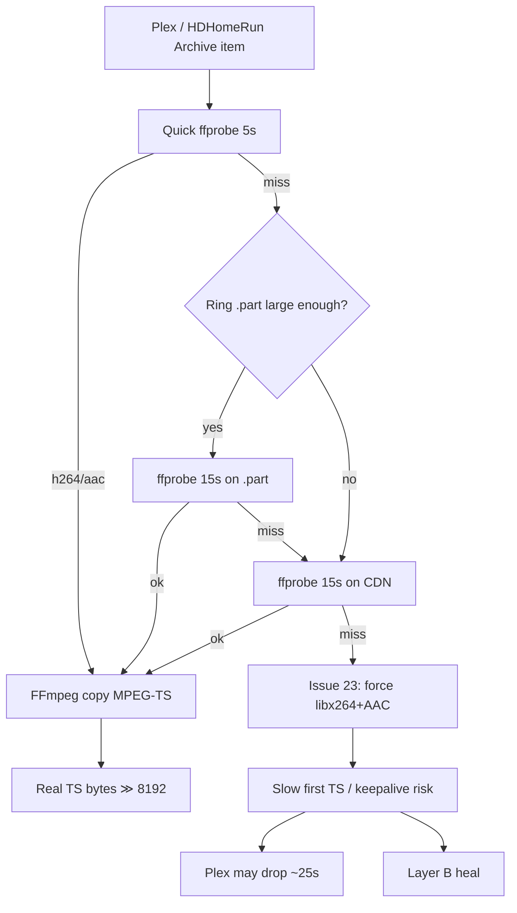
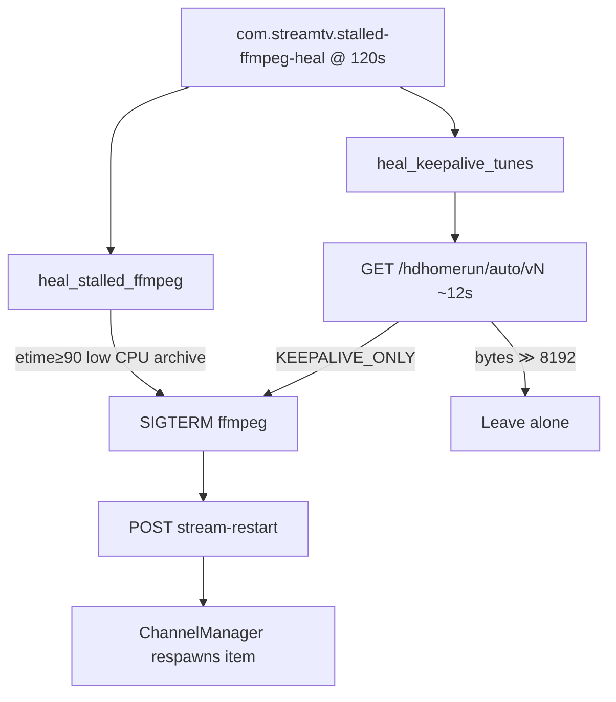
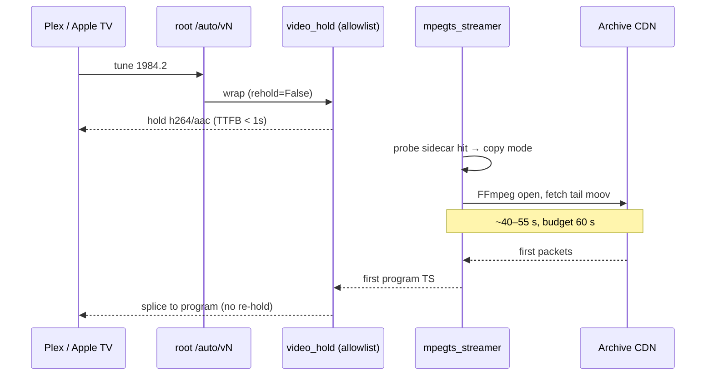

# Archive probe retry + keepalive auto-heal

**Status:** shipped (private tip / production Studio + Mini). Lessons **41b**, **41c**.

Multi-gigabyte Archive.org CDN MP4s can miss StreamTV’s **5 s** quick ffprobe even when
the file is already **H.264 + AAC**. Issue **23** correctly refuses blind copy, so a
probe miss used to force **libx264** — which often produced only HDHomeRun
**keepalive (~8192 B)** until Plex/Apple TV abandoned the tune (~25 s). The external
stall healer’s old **300 s** etime floor also skipped those wedges.

This guide covers the **two-layer** fix: safer Archive probe escalation, then
automatic unstick if a tune still wedges.

## Layer A — Archive probe escalation (bedrock)

In `mpegts_streamer._detect_input_codec` (Archive HTTP only):

1. First `_quick_ffprobe_codec` (**5 s**).
2. On miss: **one** retry at **15 s** with a larger probesize/analyzeduration.
3. Prefer a large enough ring-buffer `.part` for the retry when present; if that
   miss, still retry the **CDN** URL (incomplete `.part` must not skip CDN).
4. Only then call `_infer_mp4_codec_defaults` (force libx264+AAC).
5. Never invent copy without a successful probe (Issue 23 stays).

Kickstart `com.streamtv` after upgrading — soft-deploy does **not** reload modules.



## Layer B — automatic unstick (ops)

LaunchAgent `com.streamtv.stalled-ffmpeg-heal` every **~120 s**:

1. `heal_stalled_ffmpeg.py` — archive.org ffmpeg, not overlay/burn, pcpu≤**0.15**,
   etime≥**90 s** (was 300) → SIGTERM.
2. `heal_keepalive_tunes.py` — sample configured `/hdhomerun/auto/v*` (unwrapped, so Layer C hold bytes never mask a wedge; ~12 s); if
   **KEEPALIVE_ONLY** (~8192), kill matching stalled ffmpeg and
   `POST …/stream-restart` (soft).



Install / refresh:

```bash
bash scripts/install-stalled-ffmpeg-heal-launchagent.sh
```

Env: `STREAMTV_STALL_HEAL_MIN_ETIME=90`, `STREAMTV_STALL_HEAL_MAX_PCPU=0.15`.

## Layer C — non-faststart slow open (Lesson 41c)

Some multi-GB Archive MP4s keep the `moov` index at the **tail** (1984.2 Tape 1:
6.9 GB, 24 MiB moov). FFmpeg must fetch the tail before the first packet, so a cold
open takes **~40–55 s** — longer than Plex patience (~25 s), the probe chain, and the
old FFmpeg first-chunk wait (15 + 10 s). Three pieces close that gap:

| Piece | Where | Behavior |
|-------|-------|----------|
| Wait-phase video hold | `streamtv/tuners/video_hold.py`, root `/auto/vN` | Allowlist `STREAMTV_PLEX_VIDEO_HOLD_ARCHIVE_CHANNELS` (empty = none). Real h264/aac hold until first program TS, then splice; **no re-hold**. |
| Probe sidecar cache | `streamtv/utils/archive_probe_cache.py` (bedrock caller) | `<cache>/archive_probe/<id>/<file>.probe.json`, 30-day TTL. Only real ffprobe successes; inferred results never stored. |
| First-chunk budget | `mpegts_streamer` (bedrock, APPROVED) | archive.org HTTP: `STREAMTV_ARCHIVE_FIRST_CHUNK_SEC` (default 60, min 25). Others: 15 + 10 s. |



Seed sidecars before allowlisting a channel, and re-run after cache eviction:

```bash
./venv/bin/python3 scripts/warm_archive_probe_cache.py --channel 1984.2          # dry run
./venv/bin/python3 scripts/warm_archive_probe_cache.py --channel 1984.2 --apply
```

Allowlist rollout (LaunchAgent env, then bootout/bootstrap — kickstart does not reread
plist env):

```bash
/usr/libexec/PlistBuddy -c "Add :EnvironmentVariables:STREAMTV_PLEX_VIDEO_HOLD_ARCHIVE_CHANNELS string 1984.2" \
  ~/Library/LaunchAgents/com.streamtv.plist
```

Add channels one at a time after an Apple TV soak: Archive copy splices have a known
black-freeze risk on some devices, which is why there is no wildcard.

## Operator verify

```bash
# Expect bytes ≫ 8192 and h264/aac — never treat 8192 as success
curl -s -m 60 -o /tmp/soak.ts -w "bytes=%{size_download}\n" "http://127.0.0.1:8410/auto/vCHANNEL"
ffprobe -v error -show_entries stream=codec_name -of csv=p=0 /tmp/soak.ts

./venv/bin/python3 scripts/heal_stalled_ffmpeg.py --dry-run
./venv/bin/python3 scripts/heal_keepalive_tunes.py --dry-run
```

Logs to expect on success: `Archive.org probe retry ok … (cdn|ring)` and
`Smart copy mode` / FFmpeg `-c:v copy -c:a copy`.

**Caveat:** mid-item Archive `-ss` into a cold multi‑GB CDN object can still mean
~30 s of keepalive before first TS; Layer B recovers if the first Plex zap drops.

## Related

- [FFMPEG_STALL_KEEPALIVE.md](FFMPEG_STALL_KEEPALIVE.md) — Lesson 41 mid-stream stall
- [STREAMING_RESILIENCE_OPS.md](STREAMING_RESILIENCE_OPS.md) — keep-warm + heal cadence
- [ARCHITECTURE.md](../../ARCHITECTURE.md) — MPEG-TS remux / probe policy diagram
- Wiki: [Streaming-Resilience-Ops](../wiki/Streaming-Resilience-Ops.md) ·
  [Scripts-and-Tools](../wiki/Scripts-and-Tools.md)
- Skill: `.cursor/skills/heal-stalled-ffmpeg-keepalive`
- [PLEX_VIDEO_HOLD.md](PLEX_VIDEO_HOLD.md) — hold mux, YouTube + Archive wait-phase
- Lessons: **41**, **41b**, **41c** (private `LESSONS_LEARNED.md`)
