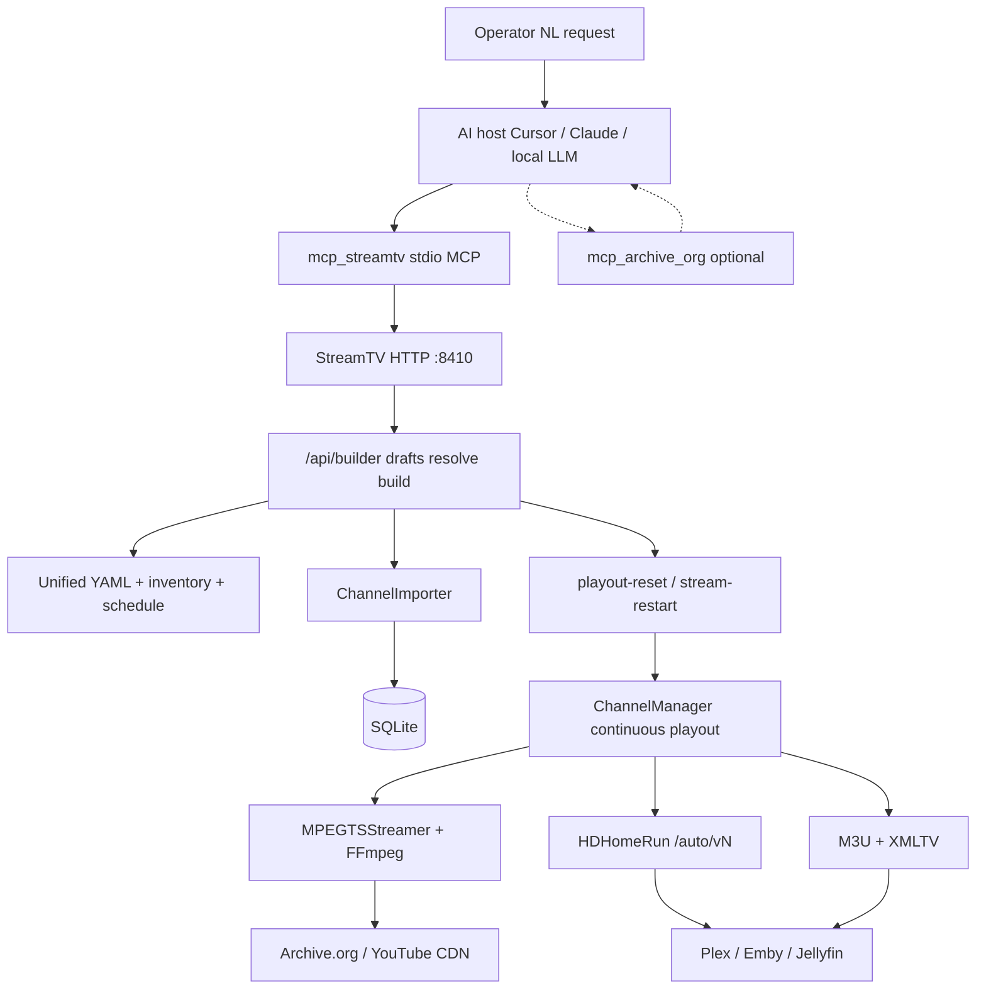
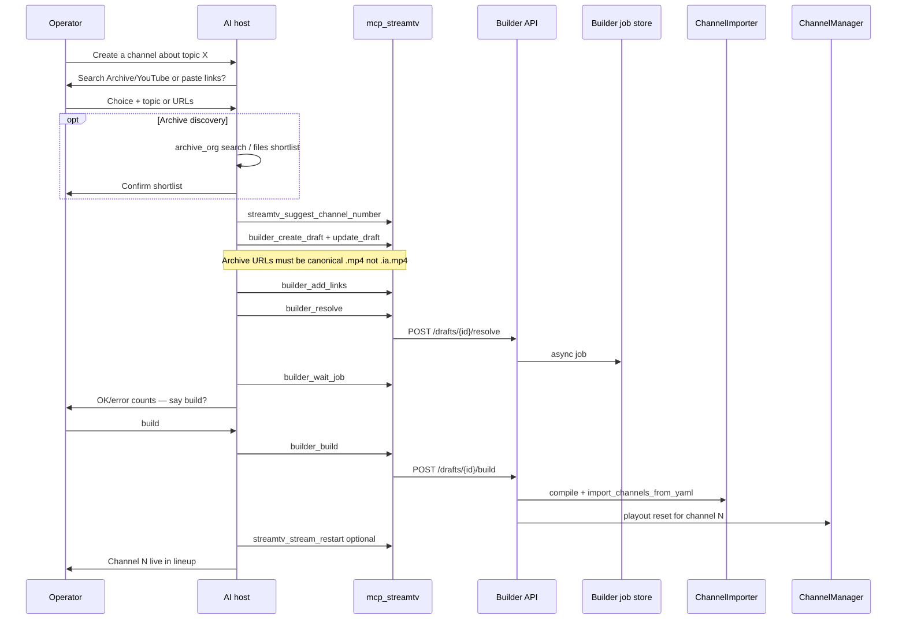
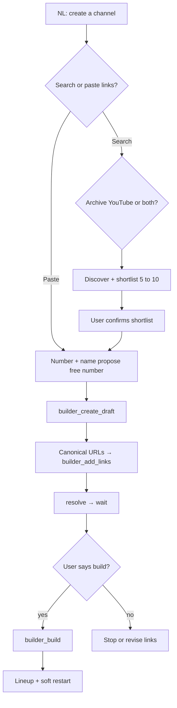
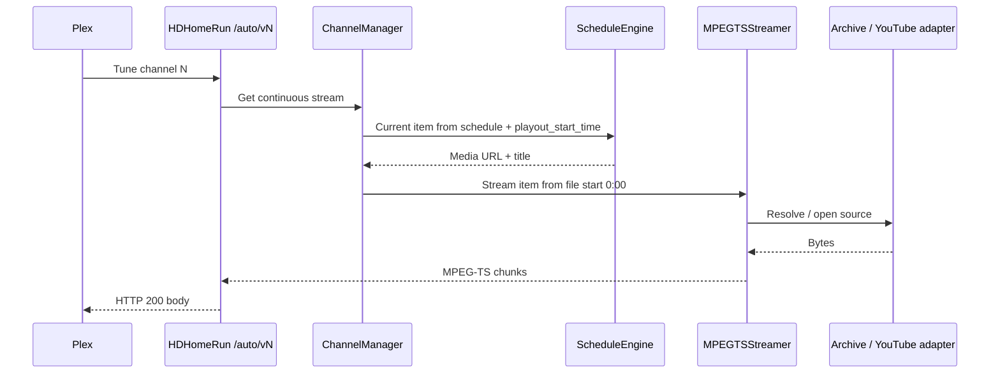
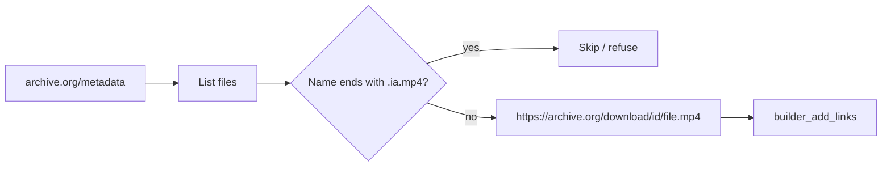
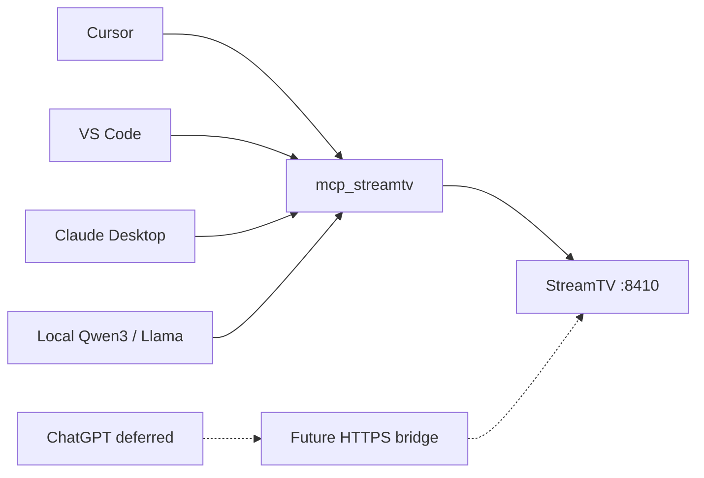

# Channel Creator MCP

Natural-language channel creation for StreamTV. An AI host (Cursor, Claude Desktop,
VS Code/Continue/Cline, or a local tool-calling model) talks to StreamTV over **stdio
MCP**. Tools call the live Channel Builder HTTP API. The model does **not** need the
streaming/FFmpeg codebase.

**Packages:** `mcp_streamtv/` (Builder + soft-deploy) · optional `mcp_archive_org/` (discovery)  
**Deps:** `requirements-mcp-streamtv.txt` · `requirements-mcp-archive-org.txt`  
**Intake:** MCP resource `streamtv://prompts/channel-intake` · prompt `channel_intake`  
**Cursor skill:** `.cursor/skills/streamtv-channel-creator/SKILL.md`  
**Rule:** `.cursor/rules/streamtv-channel-creator-mcp.mdc`

Related: [Channel Builder](../channel-builder.md) · [Import vs Builder](IMPORT_VS_BUILDER.md) ·
[Soft deploy](SOFT_DEPLOY.md) · [ARCHITECTURE.md](../../ARCHITECTURE.md)

---

## 1. What this platform is

| Piece | Role |
|-------|------|
| MCP host (LLM) | Understands NL; asks Search vs Paste; calls tools |
| `mcp_streamtv` | stdio MCP → `STREAMTV_BASE_URL` (default `http://127.0.0.1:8410`) |
| `mcp_archive_org` | Search / file list / stream URL helpers for Archive.org |
| Channel Builder API | Draft → links → resolve → build (compile + import + playout reset) |
| StreamTV runtime | Continuous playout → HDHomeRun / IPTV → Plex |

Bedrock modules (`streamtv/streaming/**`, `ffmpeg/**`, `scheduling/**`) stay frozen and
untouched by channel-create agents.

---

## 2. End-to-end signal path (create → tune)

This is the full path from a plain-language request to MPEG-TS on a tuner client.



---

## 3. Create-path sequence (Builder)



---

## 4. Intake UX (Search vs Paste)

Agents must ask (unless URLs are already pasted):

> Search Archive.org and/or YouTube, or paste links you already have?



**Defaults (do not re-ask):** derive name/group from topic; chronological for Archive;
as_added for pasted YouTube; one channel at a time; no fleet soft-restart-all.

---

## 5. After create — tune signal path

Same as production HDHomeRun once the channel exists (see [ARCHITECTURE.md](../../ARCHITECTURE.md)).



Soft deploy after MCP create: Builder already resets playout. Use
`streamtv_stream_restart` only if needed. Do **not** full `launchctl kickstart` for
channel-data-only changes — [SOFT_DEPLOY.md](SOFT_DEPLOY.md).

---

## 6. Archive.org URL rules (Issue 24)

| Forbidden | Required |
|-----------|----------|
| `*.ia.mp4` derivative URLs | Canonical `…/download/<id>/<file>.mp4` from metadata |
| Bare `/details/` or collection-only paths | Filename path after identifier |

`builder_add_links` **raises** if any URL contains `.ia.mp4`. Compile-time
`playout_guards.validate_archive_stream_urls` also rejects them.



---

## 7. Tool catalog (`mcp_streamtv`)

| Tool | Maps to |
|------|---------|
| `streamtv_suggest_channel_number` | Next free number from lineup |
| `streamtv_list_channels` / `get_channel` | `GET /api/channels` |
| `builder_list_sources` | `GET /api/builder/sources` |
| `builder_auth_status` / `builder_auth_check` | Auth status / preflight |
| `builder_create_draft` / `get` / `list` / `update` | Draft CRUD |
| `builder_add_links` | `POST …/links` (rejects `.ia.mp4`) |
| `builder_resolve` / `builder_job_status` / `builder_wait_job` | Resolve + poll |
| `builder_build` | Compile + import + playout reset |
| `builder_list_fillers` | Filler collections |
| `streamtv_playout_reset` / `streamtv_stream_restart` | Soft deploy |

Resources include schema, Channel Builder docs, intake prompt, and URL/id rules.

---

## 8. Prerequisites and host wiring

- StreamTV listening on `http://127.0.0.1:8410` (production LaunchAgent `com.streamtv`)
- `pip install -r requirements-mcp-streamtv.txt` (and archive MCP if used)
- Optional: `STREAMTV_API_KEY` when API key is required

```bash
export STREAMTV_BASE_URL=http://127.0.0.1:8410
python3 -m mcp_streamtv.main
```

**Full per-host wiring (Cursor, VS Code, Claude Desktop, ChatGPT deferred, local models)
with diagrams:** [CHANNEL_CREATOR_MCP_HOST_WIRING.md](CHANNEL_CREATOR_MCP_HOST_WIRING.md)



| Host | Fit | Start here |
|------|-----|------------|
| Cursor | Best | MCP settings + `streamtv-channel-creator` skill |
| VS Code (Continue / Cline) | Good | Same stdio MCP + intake system rule |
| Claude Desktop | Good | `claude_desktop_config.json` + prompt `channel_intake` |
| Local (Ollama) | Good @ Qwen3 32B+ | Same MCP; see model table in host-wiring guide |
| ChatGPT | Deferred | Needs authenticated remote Actions/MCP — not LAN stdio |

**Local model picks:** Qwen3 32B (default) · Llama 3.3 70B (40+ GB) · Qwen3 8B (tight RAM).

---

## 9. Artifacts produced by a successful build

| Artifact | Purpose |
|----------|---------|
| `data/unified/{N}.channel.yaml` | Authoritative unified channel doc |
| `data/channels_generated_{N}.yaml` | Compiled inventory for import |
| `schedules/{N}.yml` | Playout + XMLTV authority |
| DB channel + media rows | Runtime lineup |
| Optional `data/channel_icons/channel_{N}.png` | Guide logo (`logo_path`) |

---

## 10. Security

- Keep API keys and YouTube/Archive cookies on the operator machine
- Prefer `127.0.0.1` in sandboxed clients
- Never paste Netscape cookies into cloud chats
- Do not publish private channel packs or schedules to public docs

## Troubleshooting

| Symptom | Check |
|---------|--------|
| `.ia.mp4` refused | Use canonical `.mp4` from metadata |
| Resolve job failed | Auth cookies; URL kind; poll `builder_wait_job` errors |
| Build failed | Guards (URL path, stream ids); fix draft links and rebuild |
| In lineup but no video | Soft `streamtv_stream_restart`; soak HDHomeRun; confirm production cwd on `:8410` |
| Wrong instance | `lsof :8410` cwd must be the repo (`com.streamtv`), not Application Support |
