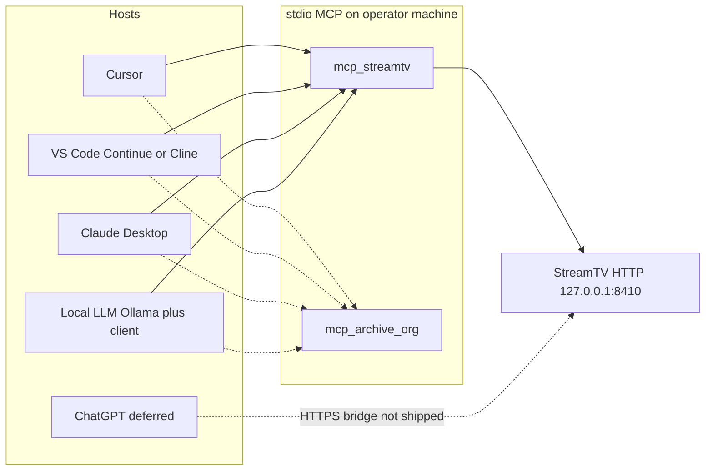
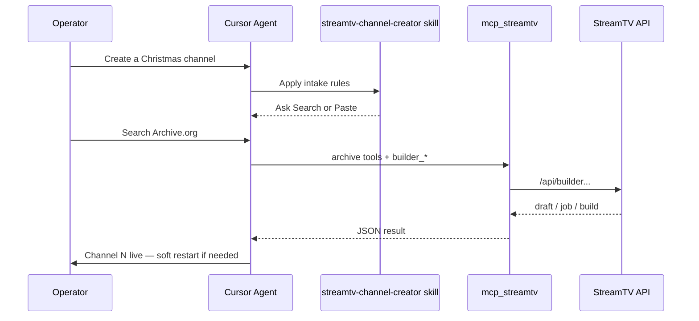
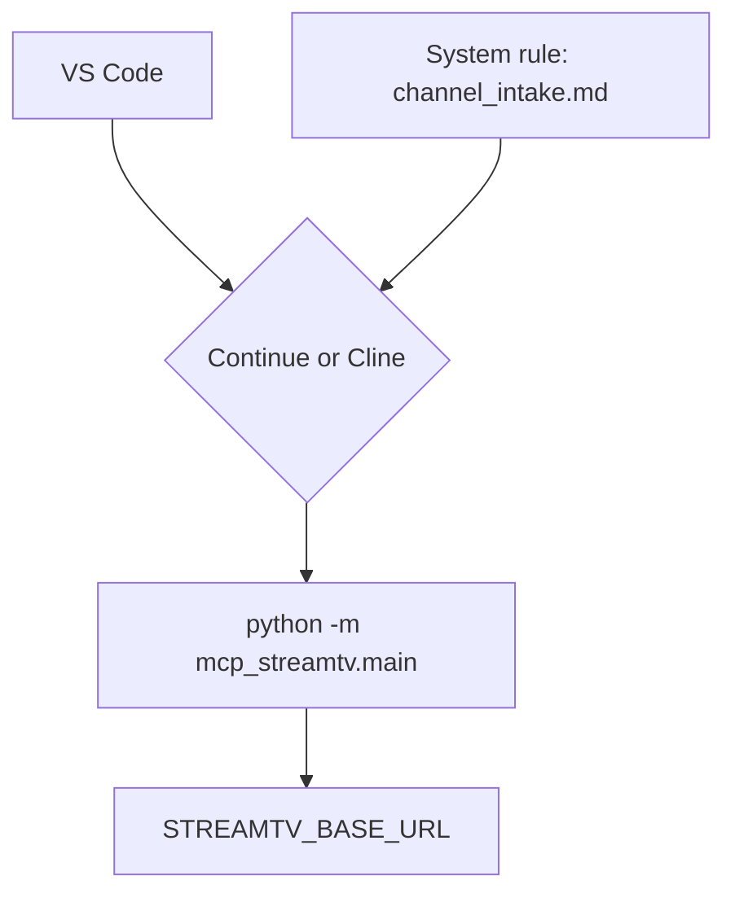
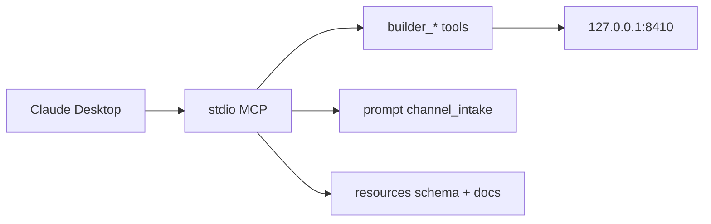
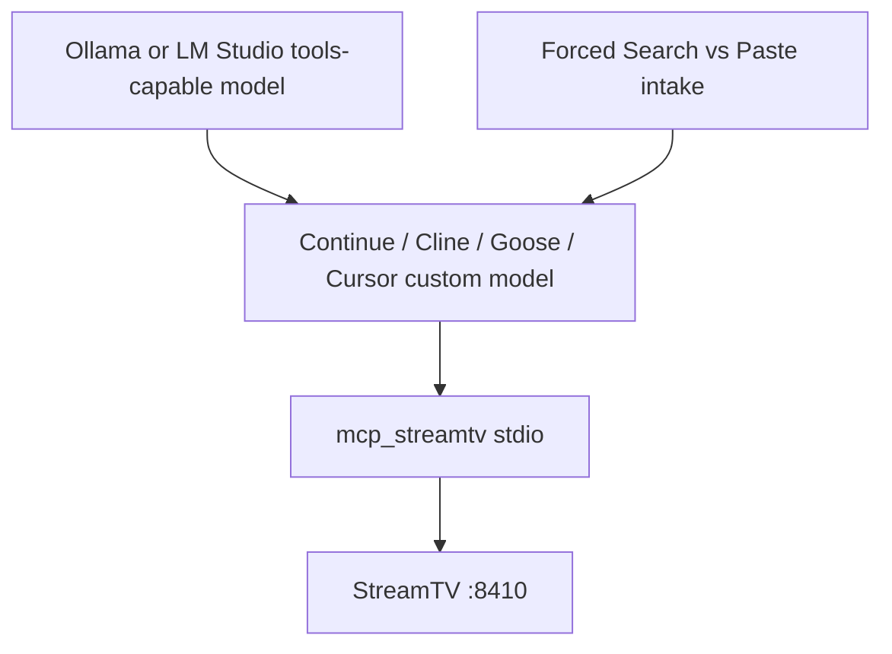
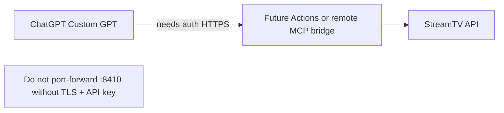

# Channel Creator MCP — host wiring

How to connect the StreamTV Channel Creator MCP to **Cursor**, **VS Code**,
**Claude Desktop**, **ChatGPT** (deferred), and **local models**.

Canonical platform guide (create/tune signal paths): [CHANNEL_CREATOR_MCP.md](CHANNEL_CREATOR_MCP.md)  
Wiki: [Channel-Creator-MCP](https://github.com/roto31/StreamTV/wiki/Channel-Creator-MCP)

---

## 1. Shared prerequisites

Every host uses the **same** stdio MCP process. Only the client config changes.

| Requirement | Detail |
|-------------|--------|
| StreamTV API | Listening on `http://127.0.0.1:8410` (or set `STREAMTV_BASE_URL`) |
| Python deps | `pip install -r requirements-mcp-streamtv.txt` |
| Optional Archive discovery | `pip install -r requirements-mcp-archive-org.txt` |
| Optional auth | `STREAMTV_API_KEY` if API key middleware is on |
| Intake | Prompt `channel_intake` / resource `streamtv://prompts/channel-intake` |

```bash
export STREAMTV_BASE_URL=http://127.0.0.1:8410
# optional: export STREAMTV_API_KEY=...
cd /path/to/StreamTV
python3 -m mcp_streamtv.main          # primary
python3 -m mcp_archive_org.main       # optional second server
```



---

## 2. Host fit matrix

| Host | Fit | Transport | Notes |
|------|-----|-----------|--------|
| **Cursor** | Best | stdio MCP + skill | Repo on disk; enable `streamtv-channel-creator` |
| **Claude Desktop** | Good | stdio MCP + prompt | Use `channel_intake` prompt |
| **VS Code** (Continue / Cline) | Good | stdio MCP + rules | Same Python entrypoints |
| **Local** (Ollama + Continue/Cline/Goose) | Good with Qwen3 32B+ | stdio MCP | Stricter intake; one tool at a time on small models |
| **ChatGPT** | Deferred | Needs HTTPS Actions / remote MCP | Do not expose LAN `:8410` publicly without auth |

---

## 3. Cursor

### Where to configure

Cursor **Settings → MCP** (user or project). Prefer project config when the StreamTV
checkout path is fixed.

### Config example

```json
{
  "mcpServers": {
    "streamtv": {
      "command": "python3",
      "args": ["-m", "mcp_streamtv.main"],
      "cwd": "/path/to/StreamTV",
      "env": {
        "STREAMTV_BASE_URL": "http://127.0.0.1:8410"
      }
    },
    "archive-org": {
      "command": "python3",
      "args": ["-m", "mcp_archive_org.main"],
      "cwd": "/path/to/StreamTV"
    }
  }
}
```

Use a venv interpreter if needed: `"/path/to/StreamTV/venv/bin/python"` instead of `python3`.

### Skill

Enable **streamtv-channel-creator** (`.cursor/skills/streamtv-channel-creator/SKILL.md`)
so agents always ask Search vs Paste and refuse `.ia.mp4` URLs.



### Verify

1. MCP panel shows `streamtv` tools (`builder_create_draft`, `builder_build`, …).
2. Ask: “List StreamTV channels” → `streamtv_list_channels`.
3. Create flow: Search vs Paste → shortlist → **build**.

---

## 4. VS Code (Continue or Cline)

Both clients speak MCP stdio. Point them at the same modules as Cursor.

### Continue

In Continue config (`config.json` / YAML, version-dependent), register an MCP server:

```json
{
  "mcpServers": [
    {
      "name": "streamtv",
      "command": "python3",
      "args": ["-m", "mcp_streamtv.main"],
      "cwd": "/path/to/StreamTV",
      "env": {
        "STREAMTV_BASE_URL": "http://127.0.0.1:8410"
      }
    }
  ]
}
```

Add a **custom instruction / system message** with the intake text from
`mcp_streamtv/prompts/channel_intake.md` (or paste the Search vs Paste first question).

### Cline

Register the MCP server in Cline’s MCP settings with the same `command` / `args` /
`cwd` / `env`. Cline validates tool schemas strictly — prefer **Qwen3 32B+** or a
cloud model with solid tool calling.



### Verify

Same as Cursor: tools visible, list channels, then a dry draft create (delete draft if unused).

---

## 5. Claude Desktop

### Config file

Edit `claude_desktop_config.json` (macOS:
`~/Library/Application Support/Claude/claude_desktop_config.json`):

```json
{
  "mcpServers": {
    "streamtv": {
      "command": "python3",
      "args": ["-m", "mcp_streamtv.main"],
      "cwd": "/path/to/StreamTV",
      "env": {
        "STREAMTV_BASE_URL": "http://127.0.0.1:8410"
      }
    },
    "archive-org": {
      "command": "python3",
      "args": ["-m", "mcp_archive_org.main"],
      "cwd": "/path/to/StreamTV"
    }
  }
}
```

Restart Claude Desktop after saving.

### Prompts / resources

- Prefer MCP prompt **`channel_intake`** at the start of a create-channel chat.
- Or ask Claude to read resource `streamtv://prompts/channel-intake`.



### Verify

Hammer icon / MCP tools list includes StreamTV Builder tools; run `builder_list_sources`.

---

## 6. Local models (Ollama / LM Studio)

MCP is **model-agnostic**. Success depends on **tool-calling** quality, not on knowing
StreamTV source.

### Recommended models (from platform plan)

| Hardware (unified / VRAM) | Model | Why |
|---------------------------|--------|-----|
| ~20–24 GB | **Qwen3 32B** (`ollama pull qwen3:32b`) | Best balance for multi-step Builder |
| ~40+ GB (e.g. Mac Studio 64 GB) | **Llama 3.3 70B** Q4 | Highest chained-tool reliability; slower |
| ~8–16 GB | **Qwen3 8B** | Usable with strict confirm gates |
| Avoid | Tiny Llama 3.2 3B-class | Weak multi-step tool scores |

Prefer general tool-call models over code-specialists for this workflow.

### Wiring pattern



Example Ollama pull:

```bash
ollama pull qwen3:32b
# or: ollama pull llama3.3:70b
```

Then attach the **same** MCP server block as Cursor/Continue, and paste the intake
prompt into the client’s system instructions.

### Local-model UX rules

- Cap shortlists to 5–10 candidates before confirm  
- Explicit “say **build** to proceed”  
- One tool call at a time for ≤8B models  
- On malformed tool args: re-ask the user — never invent channel numbers or URLs  

---

## 7. ChatGPT (deferred)

**Not supported** as a direct MCP host against a home LAN StreamTV in this release.



To support ChatGPT later you would need:

1. An authenticated HTTPS endpoint (tunnel or reverse proxy) to StreamTV  
2. OpenAPI Actions or remote MCP that wraps Builder tools  
3. Strict refusal to expose cookies, channel packs, or lab IPs  

Until then, use **Cursor**, **Claude Desktop**, **VS Code**, or **local Ollama** clients.

---

## 8. Smoke test (any host)

After wiring:

1. `streamtv_list_channels` or `builder_list_sources` succeeds.  
2. Intake asks Search vs Paste when you say “create a channel about …”.  
3. `builder_add_links` rejects a deliberate `….ia.mp4` URL (Issue 24).  
4. Optional: create a draft, resolve one known-good Archive `.mp4`, cancel before build if this is only a wiring test.

---

## 9. Security checklist

- [ ] `STREAMTV_BASE_URL` points at loopback (or trusted LAN), not a public URL  
- [ ] API key set when required; never committed  
- [ ] Cookies stay on the operator machine  
- [ ] ChatGPT / cloud hosts do not receive Netscape cookie files or private YAML packs  
