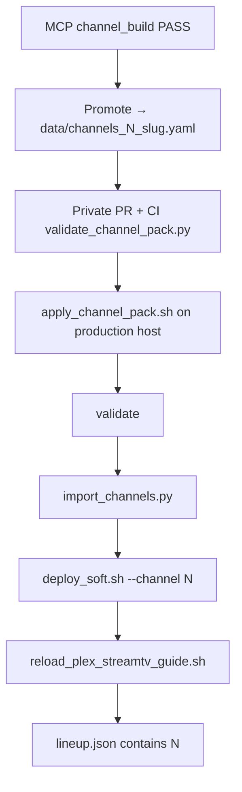

# Channel pack GitOps (private)

Hybrid GitOps for **compiled** StreamTV channels: YAML in private git is desired
state; apply on the Mac Studio reconciles DB + soft-deploy + Plex guide. MCP 2.0
remains the **authoring** UX (search → shortlist → plan → build). This guide does
**not** put NL discovery into CI.

**Scope:** private `roto31/StreamTV-source` only. Channel packs must **never**
ship to public `roto31/StreamTV` (see `config/public_release_manifest.yaml`).

**Frozen:** do not edit `streamtv/scheduling/**`, `streaming/**`, `ffmpeg/**`,
`hdhomerun/**`, or `streamtv/api/iptv.py` for this workflow. Apply uses existing
import + soft-deploy + Plex reload APIs only.

Related: [Channel Creator MCP](CHANNEL_CREATOR_MCP.md) · [Soft deploy](SOFT_DEPLOY.md) ·
[Import vs Builder](IMPORT_VS_BUILDER.md) · [Plex Live TV recovery](../plex/PLEX_LIVE_TV_RECOVERY.md)

---

## 1. Roles

| Role | Owns | Does not own |
|------|------|----------------|
| MCP / human | Discovery, shortlist, `plan_token`, confirm=build | Production CD |
| Private git | Channel YAML + schedule (+ optional icon/SOURCES) | `streamtv.db`, TunarrRAM, Plex DVR id |
| CI (PR) | Schema + validator + schedule parse (offline) | Live import / tunes |
| Apply on host | Import → soft deploy → Plex `reloadGuide` → lineup smoke | Kickstart / bedrock edits |

---

## 2. Path contract

### 2.1 Authoring (MCP local write)

After a PASS `channel_build` / `newchannel-build`:

| Path | Git | Notes |
|------|-----|--------|
| `data/channels_generated_<n>.yaml` | **Ignored** (`.gitignore`) | Runtime import target today |
| `schedules/<n>.yml` | Often tracked | Required sibling |
| `data/unified/<n>.channel.yaml` | Operator choice | Optional compile source |
| `data/builder_drafts/newchannel_<n>.build.json` | Local | Rollback manifest; do not publish |

### 2.2 Desired state (commit on private `main`)

Promote before (or in) the PR — **do not** commit gitignored generated names as the
long-term source of truth:

| Path | Required | Naming |
|------|----------|--------|
| `data/channels_<n>_<slug>.yaml` | Yes | Same `channels:` schema as generated; slug = `snake_case` theme |
| `schedules/<n>.yml` | Yes | Lookup order unchanged (parser bedrock — read only) |
| `data/channel_icons/<n>.png` (or svg) | Optional | Static icon for guide |
| `data/unified/<n>.channel.yaml` | Optional | If you maintain unified as edit surface |
| `SOURCES.md` / `urls.tsv` next to pack | Optional | Evidence; keep private |

**Promote command (manual):**

```bash
N=1226
SLUG=vintage_kids_st_patricks
cp "data/channels_generated_${N}.yaml" "data/channels_${N}_${SLUG}.yaml"
# schedules/${N}.yml already written by MCP — include in the same commit
```

Keep `channels_generated_<n>.yaml` on disk for local import convenience, or
re-copy from the tracked pack before apply:

```bash
cp "data/channels_${N}_${SLUG}.yaml" "data/channels_generated_${N}.yaml"
```

### 2.3 Explicit non-goals for git

- `streamtv.db`, playout anchors, cache files
- cookies / `config.yaml` / Plex token
- Public repo channel inventory
- Editing existing channel numbers via this path (MCP G5 / new-channel-only)

---

## 3. PR → CI (validate only)

Offline gate — **no** `:8410` import, **no** YouTube/Archive probes in CI by default.

```bash
./venv/bin/python scripts/validate_channel_pack.py \
  --channel-yaml data/channels_${N}_${SLUG}.yaml \
  --schedule schedules/${N}.yml
```

Checks (wrapper around existing validators):

1. JSON Schema (`schemas/channel.schema.json`, `schemas/schedule.schema.json`) via `YAMLValidator`
2. Channel + schedule file validation
3. Schedule keys ⊆ channel collections (same spirit as builder G3)
4. Refuse `.ia.mp4` Archive URLs
5. Optional: `--unified data/unified/${N}.channel.yaml` → `validate_unified_channel`

Availability / exact runtime (builder G6) stays **MCP-time** or operator
`--probe` later — not default CI (flaky network).

CI wiring (when added): run the script on changed `data/channels_*.yaml` + matching
`schedules/<n>.yml` paths; fail the PR on non-zero exit. Do **not** fail public
sync CI for private packs (packs are excluded from public).

---

## 4. Apply sequence (Mac Studio production)



Preconditions (Issue 42/43):

```bash
lsof -nP -iTCP:8410 -sTCP:LISTEN
# cwd must be this repo (com.streamtv), not Application Support
curl -sf http://127.0.0.1:8410/health >/dev/null
```

One-shot:

```bash
bash scripts/apply_channel_pack.sh \
  --channel-yaml data/channels_${N}_${SLUG}.yaml \
  --schedule schedules/${N}.yml \
  --number "${N}"
```

| Step | Action | Failure |
|------|--------|---------|
| 0 | Confirm production listener | Exit 2 |
| 1 | `validate_channel_pack.py` | Exit 1 — no import |
| 2 | Sync copy → `data/channels_generated_<n>.yaml` (optional mirror) | Exit 1 |
| 3 | `python scripts/import_channels.py <channel-yaml>` | Exit 1 |
| 4 | `bash scripts/deploy_soft.sh --channel <n>` | Exit 1 |
| 5 | `bash scripts/reload_plex_streamtv_guide.sh` | **WARN** (exit 0 with note) unless `--strict-plex` |
| 6 | Smoke: `curl …/lineup.json` contains `GuideNumber` / number | Exit 1 if missing |

Still use **full kickstart** only for `streamtv/` module or LaunchAgent env changes —
not for YAML pack apply ([Soft deploy](SOFT_DEPLOY.md)).

`--dry-run` runs steps 0–1 only and prints the remaining plan.

---

## 5. MCP handoff checklist

After guided `channel_build` PASS:

1. Confirm gates `summary_table` overall PASS.
2. Promote `channels_generated_<n>.yaml` → `channels_<n>_<slug>.yaml`.
3. Open private PR with channel YAML + `schedules/<n>.yml` (+ icon).
4. CI validate green.
5. Merge; on Studio run `apply_channel_pack.sh` (or soft-deploy was already done by
   MCP — re-apply is idempotent import + soft restart of **one** channel).
6. Wait for Plex guide (1–2 min); spot-check tune once (YouTube: soak ≥50s /
   CACHE HIT — Issues 62–64).

Do **not** `stream-restart-all` or multi-YouTube probe after create.

---

## 6. Drift (phase 2 — not required for MVP)

Later optional reconciler:

- Diff enabled channel numbers in DB vs tracked `data/channels_*.yaml` + schedules
- Report-only by default; apply only with explicit `--reconcile`

Out of scope until MVP apply is routine: deleting retired packs from DB via git
alone, multi-host CD, public GitOps.

---

## 7. Safety / policy map

| Rule | Implication |
|------|-------------|
| `streamtv-audit-preserve-wip` | Do not commit MCP drafts / WIP builder paths unless owner names them |
| `streamtv-public-repo-sync` | Packs stay private; public sync must not grow include globs for `data/channels_*` |
| `streaming-bedrock-frozen` | No schedule-engine changes for GitOps |
| TunarrRAM | Apply ≠ fleet probe; one channel soft deploy only |

---

## 8. Implementation status

| Artifact | Status |
|----------|--------|
| This contract | Living doc |
| `scripts/validate_channel_pack.py` | MVP offline gate |
| `scripts/apply_channel_pack.sh` | MVP host apply |
| GitHub Action on private PR | Deferred (run script locally / add when ready) |
| Automatic promote from MCP | Deferred |
| DB↔git drift reconciler | Deferred (phase 2) |
