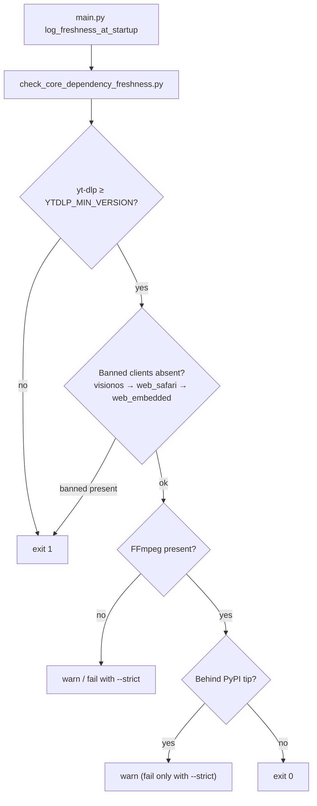

# Core dependency freshness (Issue 73)

StreamTV’s YouTube path tracks **yt-dlp** and `player_client` policy harder than
most other deps. Stale wheels cause fleet-wide googlevideo **403** with no bedrock
change.

Floor + clients live in `streamtv/ffmpeg/constants.py` (`YTDLP_MIN_VERSION`,
`YOUTUBE_PLAYER_CLIENTS`). Keep `requirements.txt` and
`scripts/upgrade-yt-dlp-production.sh` in sync when the floor changes (owner
`APPROVED:` required for constants).

## Check flow



## Operator commands

```bash
./venv/bin/python scripts/check_core_dependency_freshness.py
./venv/bin/python scripts/check_core_dependency_freshness.py --json
./venv/bin/python scripts/check_core_dependency_freshness.py --strict
```

Weekly LaunchAgent `com.streamtv.ytdlp-upgrade` (Sunday 04:15) must stay
bootstrapped. First-run jobs also call `ensure_yt_dlp_current()`.

## Preferred YouTube clients

| Order | Client | Notes |
|-------|--------|--------|
| 1 | `visionos` | Primary after Issue 73 |
| 2 | `web_safari` | Fallback |
| 3 | `web_embedded` | Fallback |

Do **not** put `android_vr`, `web`, `android`, `ios`, or `mweb` first without a
PO Token provider (`android_vr` GVS-403s — yt-dlp #17456).

## Related

- [First-run setup](FIRST_RUN_SETUP.md)
- [Plex Playback Error host](PLEX_PLAYBACK_ERROR_HOST.md) (prove StreamTV soak before blaming Plex)
- [YouTube geo-blocks](YOUTUBE_GEO_BLOCKS.md)
