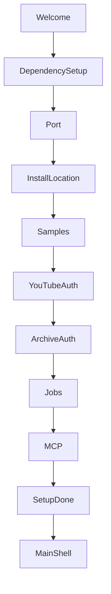
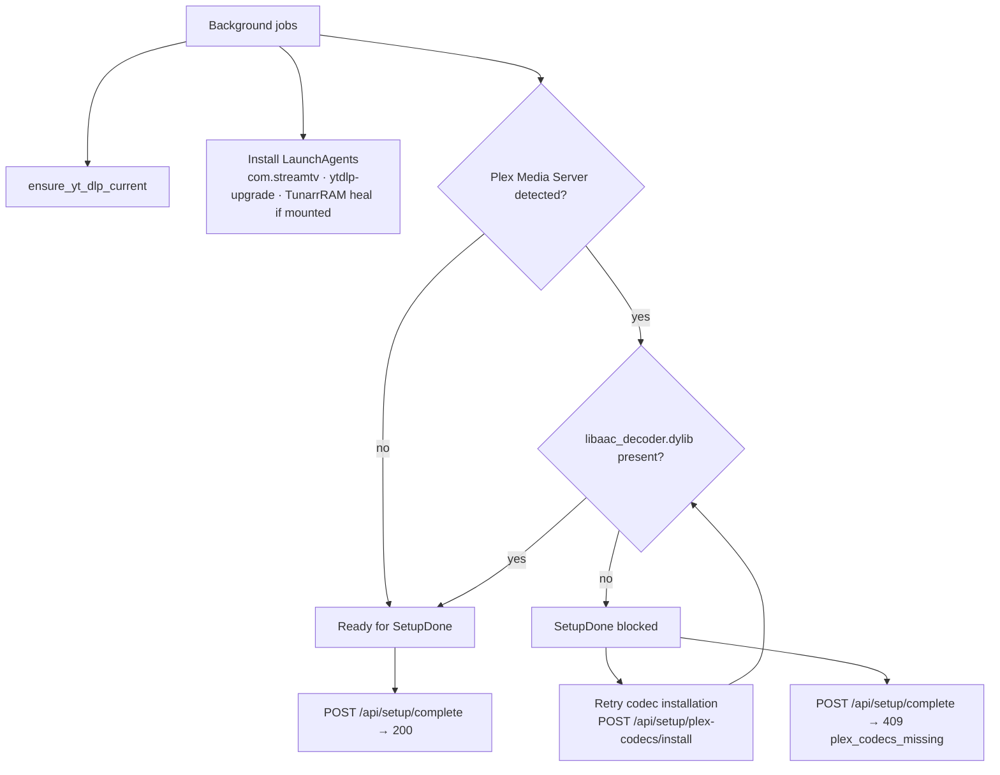

# First-run setup

StreamTV first-run runs through **StreamTV.app** onboarding (Welcome → DependencySetup → Port → Install location → Sample channels → YouTube/Archive sign-in → MCP offer → SetupDone). LaunchAgent-only installs use WebUI `/setup`.

## Prompts vs background

- **Prompted:** install location (Standard App Support vs Advanced repo), optional
  sample channels (9101–9104), port, YouTube/Archive sign-in, MCP Yes/hosts,
  **Retry codec installation** when Plex is present but AAC packs are missing
- **Background:** config seed, FFmpeg/ffprobe, **yt-dlp floor/upgrade**, **Plex AAC
  codecs** verify/install, LaunchAgents (`com.streamtv`, yt-dlp upgrade, TunarrRAM
  heal if mounted), DB ready, auth status lines

Universal production bootstrap (no Studio lab settings): [PRODUCTION_BOOTSTRAP_UNIVERSAL.md](PRODUCTION_BOOTSTRAP_UNIVERSAL.md).

## yt-dlp (not DMG-bundled)

yt-dlp installs into the active venv via `requirements.txt`. First-run jobs call
`ensure_yt_dlp_current()` (floor from `YTDLP_MIN_VERSION`, optional PyPI tip).
Operator check: `./venv/bin/python scripts/check_core_dependency_freshness.py`.

## Background jobs + SetupDone gate

## Plex AAC codecs (Issue 72)

When Plex Media Server is detected, **SetupDone is blocked** until
`libaac_decoder.dylib` exists under
`~/Library/Application Support/Plex Media Server/Codecs/`.
`POST /api/setup/complete` returns **409** `plex_codecs_missing` until
`POST /api/setup/plex-codecs/install` (or `scripts/install_plex_aac_codecs.sh`)
succeeds. Plex-absent installs skip the gate.

See [Plex Playback Error host](PLEX_PLAYBACK_ERROR_HOST.md) § Remux / AAC ·
[Core dependency freshness](CORE_DEPENDENCY_FRESHNESS.md).

See also [SetupDone and factory reset](SETUP_DONE_AND_FACTORY_RESET.md), [Source auth](SOURCE_AUTH_YOUTUBE_ARCHIVE.md).
