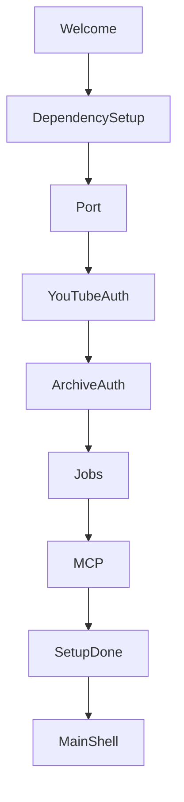

# First-run setup

StreamTV first-run runs through **StreamTV.app** onboarding (Welcome → DependencySetup → Port → YouTube/Archive sign-in → MCP offer → SetupDone). LaunchAgent-only installs use WebUI `/setup`.

## Prompts vs background

- **Prompted:** port conflict (**Set Port**), YouTube/Archive sign-in, MCP Yes/hosts
- **Background:** config seed, FFmpeg/ffprobe checks, DB ready, auth status lines

See also [SetupDone and factory reset](SETUP_DONE_AND_FACTORY_RESET.md), [Source auth](SOURCE_AUTH_YOUTUBE_ARCHIVE.md).
