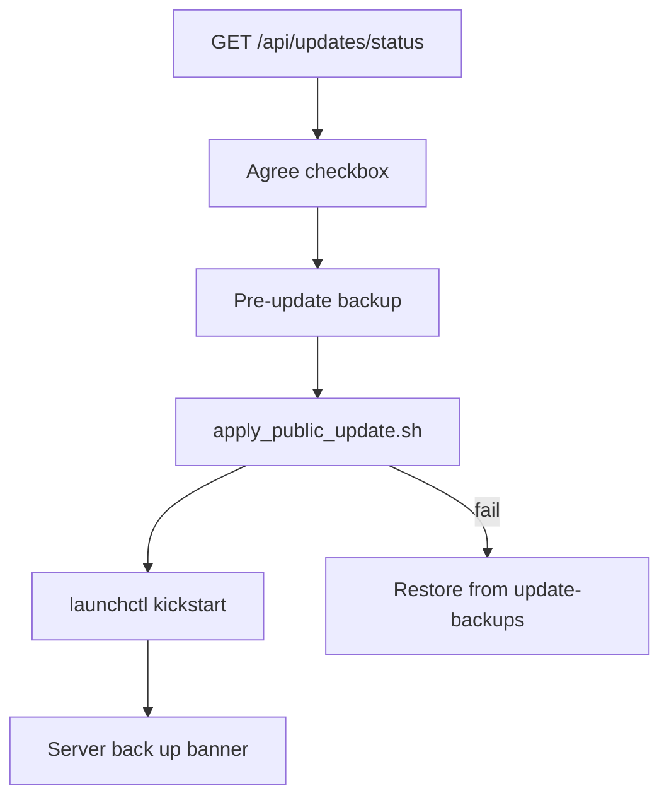

# In-app Updates

Settings → **Updates** (`/settings/updates`).

- **install_mode:** `app` (Application Support) vs `repo` (LaunchAgent)
- **Download DMG:** `/api/updates/dmg` → latest GitHub release `.dmg`
