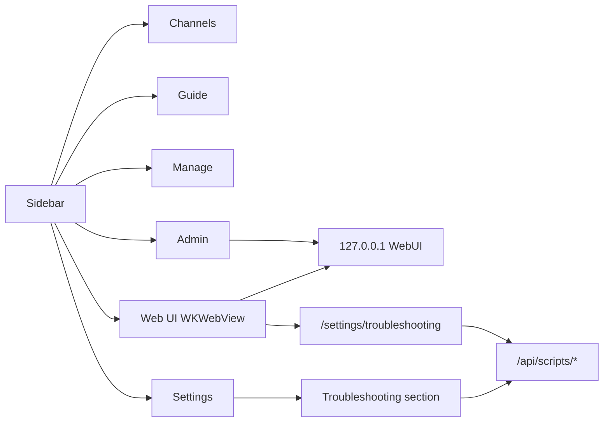

# macOS app — Web UI sidebar

StreamTV.app sidebar includes **Web UI** (WKWebView of local server) so every WebUI admin action works in-app without Safari.

Settings **Switch to Web UI tab** selects that sidebar item; **Open in Browser** remains available. Native **Settings → Troubleshooting** mirrors the WebUI Scripts catalog (hover help + Run).
