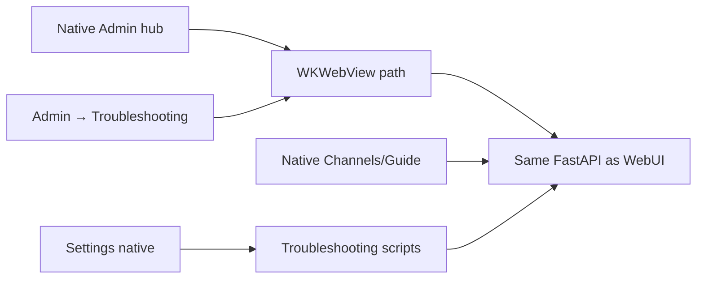

# Native admin parity

| Phase | Surfaces |
|-------|----------|
| P1 | Dashboard, Channels, Import, Auth, Settings subtree (incl. **Troubleshooting**), Logs, Health, Cache, Test stream, Updates |
| P2 | Media, Playlists, Playouts, Schedules, Builder, Documentation |

Full WebUI remains on the **Web UI** tab as fallback while individual Swift forms expand. **Troubleshooting** scripts use `/api/scripts/list` + `/api/scripts/{id}/run` (hover = catalog `hover` text).
