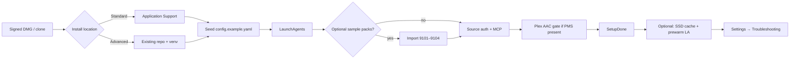

# Production bootstrap (universal)

Goal: a brand-new Mac gets a **Studio-class** StreamTV server without copying
any lab-specific Studio settings (LAN IPs, TunarrRAM paths, `dvr_id`, private
fleet YAML).



After SetupDone, operators may point `cache.cache_directory` at an SSD, raise `prefetch_count`, and install `com.streamtv.prewarm-youtube` — see [STREAMING_RESILIENCE_OPS.md](STREAMING_RESILIENCE_OPS.md).

## What first-run installs

| Piece | Behavior |
|-------|----------|
| Config | Seeded from `config.example.yaml` only (`base_url` localhost) |
| venv + deps | Application Support (app) or existing repo venv (advanced) |
| yt-dlp | Floor / tip ensure (`ensure_yt_dlp_current`) |
| `com.streamtv` | [`scripts/install-com-streamtv-launchagent.sh`](../../scripts/install-com-streamtv-launchagent.sh) — WorkingDirectory = chosen workdir |
| `com.streamtv.ytdlp-upgrade` | Weekly upgrade agent |
| TunarrRAM heal | **Only if** `/Volumes/TunarrRAM` already exists |
| Plex AAC | Hard gate when PMS is detected |
| Sample channels | Optional 9101–9104 under `data/starter_packs/` (private product) |

## Install location

- **Standard:** `~/Library/Application Support/StreamTV`
- **Advanced:** user-selected repo path — must already contain `venv/` and importable `streamtv` (clone + `pip install -r requirements.txt` first)

## Never auto-copied from Studio

- `/Volumes/SSD Storage/...` workdirs
- `192.168.1.x` base URLs / external / Plex hosts
- `plex.dvr_id`, cookies, private `data/unified/` fleet
- Studio LaunchAgent `EnvironmentVariables` (`STREAMTV_CACHE_YOUTUBE_FULL_CACHE=true`, etc.)

## Optional after first-run

1. Mount or create TunarrRAM → install heal agent → enable `youtube_full_cache` if desired.
2. Set Plex hosts for your LAN.
3. Add StreamTV as HDHomeRun in Plex; reload guide after lineup exists.
4. Import your own channel packs (GitOps) instead of / in addition to samples.

## Sample packs policy

Starter packs mirror **Studio curation** (Archive.org availability, Top-of-genre
music rules). They are **not** PD/CC filler packs. PD/CC titles appear only when
a curated pick has entered that status. Packs live in `data/starter_packs/` and
are **excluded from public repo sync**.

Validate:

```bash
./venv/bin/python scripts/validate_starter_pack.py
```

See also [FIRST_RUN_SETUP.md](FIRST_RUN_SETUP.md), [FIRST_CHANNEL_15_MIN.md](FIRST_CHANNEL_15_MIN.md),
[Core dependency freshness](CORE_DEPENDENCY_FRESHNESS.md), [Channel pack GitOps](CHANNEL_PACK_GITOPS.md).
