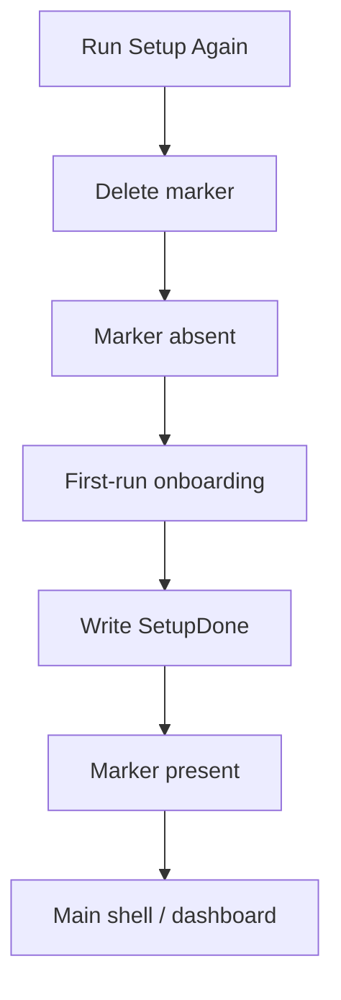

# SetupDone and factory reset

AppleSetupDone-style marker: `~/Library/Application Support/StreamTV/.StreamTVSetupDone`  
Repo/LaunchAgent also may write `.streamtv-setup-done` next to cwd.

JSON contents: `completed_at`, `app_version`, `setup_schema_version`.

**Run Setup Again** (Settings): confirms, clears marker (optional config reseed), returns to first-run. Does not delete channel YAML by default.
