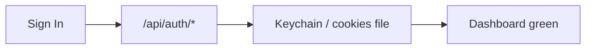

# YouTube and Archive.org source authentication

Dashboard **Sign In** links: `/api/auth/youtube`, `/api/auth/archive-org`.

- **YouTube:** cookies upload and/or OAuth — path in config; never store Google password in YAML
- **Archive.org:** username/password → macOS Keychain; cookies file optional
- Templates load from **absolute** `streamtv/templates` so Application Support cwd does not 500

First-run prompts both sign-ins. Re-auth when dashboard status is red.
