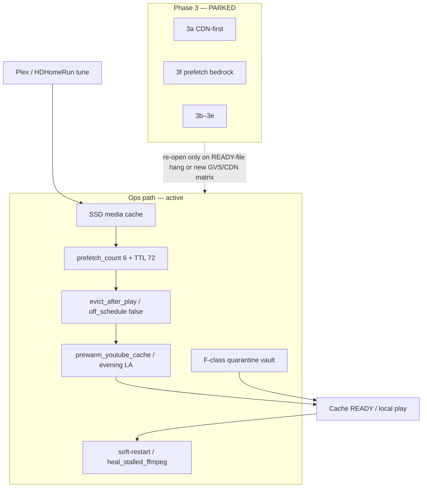

# Streaming resilience — ops (Phase 3 parked)

**Status (2026-11-25):** Phase **3** frozen-path packages (**3a–3f**) are **PARKED**. Studio/Mini reliability is maintained with SSD cache, keep-warm config, quarantine, and optional pre-warm — not bedrock edits.

Canonical gate: [`docs/plans/streaming-resilience-phase3-gate-20261125.md`](../plans/streaming-resilience-phase3-gate-20261125.md).

## Keep-warm knobs (`config.yaml` → `cache`)

| Knob | Typical | Purpose |
|------|---------|---------|
| `cache_directory` | SSD path (not 2 GiB TunarrRAM) | Avoid ENOSPC on YouTube full-cache |
| `prefetch_count` | **6** | Deeper N+k under concurrency-1 |
| `default_ttl_hours` | **72** | Keep music VODs warm |
| `evict_after_play` / `evict_off_schedule` | **false** | Retain READY files across zaps |
| `youtube_full_cache` | **true** | Local file playout (no CDN mid-song) |

## Operator scripts

| Script | When |
|--------|------|
| `scripts/prewarm_youtube_cache.py` | Before evening Plex; or after kickstart |
| `scripts/kickstart_streamtv_with_prewarm.sh` | Full LaunchAgent reload + pre-warm |
| `scripts/install-prewarm-youtube-launchagent.sh` | Daily 17:00 local (optional) |
| `scripts/heal_stalled_ffmpeg.py --dry-run` / `--apply` | Keepalive-only / 0% CPU Archive FFmpeg |
| `scripts/deploy_soft.sh` | Restart streams without Python reload |

WebUI / macOS Settings → **Troubleshooting** expose the public-safe subset (hover for help).

## Cold YouTube vs READY hang

- **Cold wait:** `download_now` / tune-buffer → wait for `Cache READY`; do **not** soft-restart mid-download.
- **READY hang:** real media path already local but stream is keepalive-only → soft-restart channel or stalled-FFmpeg heal. **Only then** consider lifting Phase **3f**.

## Quarantine

Dead YouTube / fragile Archive assets live under `data/quarantine/` (e.g. `dead_youtube_fclass_20261125.yaml`) and are removed from channel inventories / schedules.
