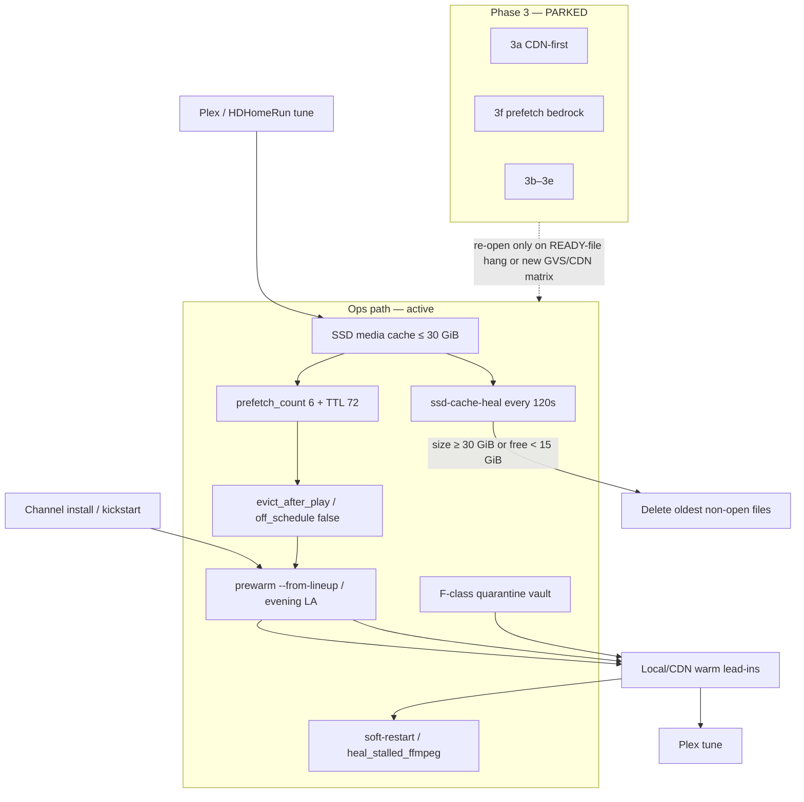

# Streaming resilience — ops (Phase 3 parked)

**Status (2026-11-26):** Phase **3** frozen-path packages (**3a–3f**) are **PARKED**. Studio/Mini reliability is maintained with SSD cache, keep-warm config, quarantine, and optional pre-warm — not bedrock edits.

Canonical gate: [`docs/plans/streaming-resilience-phase3-gate-20261125.md`](../plans/streaming-resilience-phase3-gate-20261125.md).

## Standard cold-tune loop

1. **In-process auto-warm (primary)** — with `youtube_full_cache` + `auto_warm_enabled`, idle tune-only ChannelStreams enqueue/prioritize the wall-clock YouTube window every `auto_warm_interval_seconds` (default 60). Soft-deploy does **not** load this module change — kickstart after upgrade.
2. **Post-install / kickstart assist** — sequential HDHR prewarm (`scripts/prewarm_youtube_cache.py`, prefer `--from-lineup` or `kickstart_streamtv_with_prewarm.sh`) still helps first READY after a cold cache.
3. **Evening LA** — `com.streamtv.prewarm-youtube` (installer wires `--from-lineup`) remains an optional soak before typical Plex evenings.
4. **SSD heal** — `com.streamtv.ssd-cache-heal` every ~120s enforces the **30 GiB** media-cache ceiling (and volume free-floor).
5. **Stall probe / heal** — `com.streamtv.stalled-ffmpeg-heal` every ~120s runs `heal_stalled_ffmpeg.py` (etime≥**90**s) then `heal_keepalive_tunes.py` (keepalive-only `/auto/v*` → kill + soft-restart). Manual: `probe_hdhr_hang.py`.

Archive cold tunes are included when using `--from-lineup` (not YouTube-only). Do **not** rewrite schedules to force Archive lead-ins — that breaks long-form Olympics/day-part playlists.

**1984.2 class (Archive probe miss):** multi-GB CDN MP4s can miss the 5s quick ffprobe → forced libx264 → keepalive-only until Plex drops. Bedrock retries probe (15s / ring `.part`) before force-transcode; healer catches residual 0% CPU wedges. Full diagrams: [ARCHIVE_PROBE_RETRY_KEEPALIVE.md](ARCHIVE_PROBE_RETRY_KEEPALIVE.md).

## Keep-warm knobs (`config.yaml` → `cache`)

| Knob | Typical | Purpose |
|------|---------|---------|
| `cache_directory` | SSD path (not 2 GiB TunarrRAM) | Avoid ENOSPC on YouTube full-cache |
| `max_size_gb` | **30.0** | In-process LRU ceiling for media cache |
| `prefetch_count` | **6** | Deeper N+k under concurrency-1 |
| `default_ttl_hours` | **72** | Keep music VODs warm |
| `evict_after_play` / `evict_off_schedule` | **false** | Retain READY files across zaps |
| `youtube_full_cache` | **true** | Local file playout (no CDN mid-song) |
| `auto_warm_enabled` | **true** | Idle channels keep on-air YouTube window downloading |
| `auto_warm_interval_seconds` | **60** | Cadence for idle auto-warm passes |

## SSD healer knobs (LaunchAgent env)

| Env | Default | Purpose |
|-----|---------|---------|
| `STREAMTV_CACHE_DIR` | Prefer env → config → `~/Library/Application Support/StreamTV/cache` | Media cache root (never TunarrRAM) |
| `STREAMTV_SSD_CACHE_MAX_GB` | **30** | External healer size ceiling (align with `cache.max_size_gb`) |
| `STREAMTV_SSD_CACHE_MIN_FREE_GB` | **15** | Volume free-floor; purge when free space drops below |

Install: `bash scripts/install-streamtv-ssd-cache-heal-launchagent.sh`

## Operator scripts

| Script | When |
|--------|------|
| `scripts/prewarm_youtube_cache.py` | Before evening Plex; or after kickstart. Use `--from-lineup` for full lineup (YouTube + Archive) |
| `scripts/kickstart_streamtv_with_prewarm.sh` | Full LaunchAgent reload + pre-warm |
| `scripts/install-prewarm-youtube-launchagent.sh` | Daily 17:00 local with `--from-lineup` |
| `scripts/install-streamtv-ssd-cache-heal-launchagent.sh` | Periodic SSD heal @ 30 GiB / 15 GiB free |
| `scripts/heal_streamtv_ssd_cache.py --dry-run` | Confirm cap / dir before applying |
| `scripts/heal_stalled_ffmpeg.py` / `heal_keepalive_tunes.py` | Lesson 41 + keepalive-only Archive wedges (etime≥90s) |
| `scripts/install-stalled-ffmpeg-heal-launchagent.sh` | Periodic stalled-FFmpeg + keepalive heal @ 120s |
| `scripts/heal_stalled_ffmpeg.py --dry-run` / `--apply` | Keepalive-only / 0% CPU Archive FFmpeg |
| `scripts/deploy_soft.sh` | Restart streams without Python reload |

WebUI / macOS Settings → **Troubleshooting** expose the public-safe subset (hover for help).

## Cold YouTube vs READY hang

- **Cold wait:** `download_now` / tune-buffer → wait for `Cache READY`; do **not** soft-restart mid-download.
- **READY hang:** real media path already local but stream is keepalive-only → soft-restart channel or stalled-FFmpeg heal. **Only then** consider lifting Phase **3f**.

## Quarantine

Dead YouTube / fragile Archive assets live under `data/quarantine/` (e.g. `dead_youtube_fclass_20261125.yaml`) and are removed from channel inventories / schedules.
