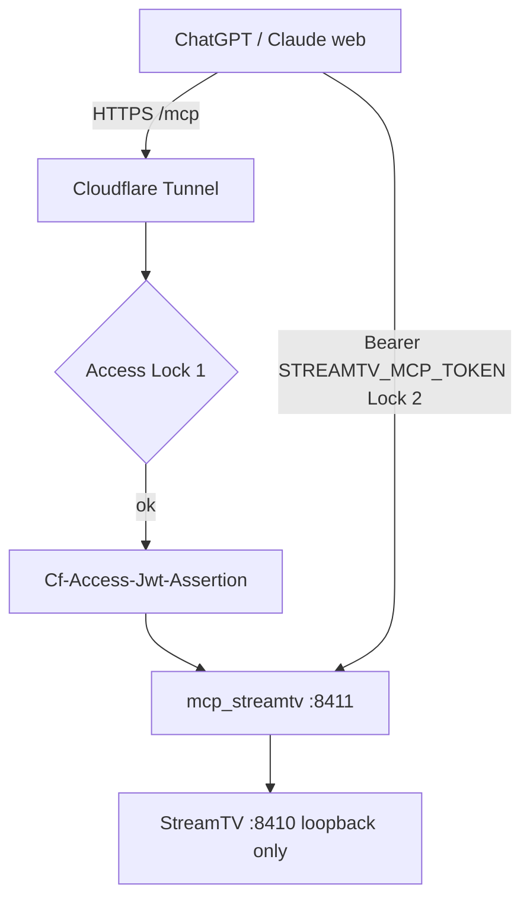

# Channel Creator MCP — HTTP auth

Streamable HTTP MCP listens on **`:8411`** (never tunnel StreamTV **`:8410`**).

**Also on this wiki:** [Platform overview](Channel-Creator-MCP) · [Host wiring](Channel-Creator-MCP-Host-Wiring)

| Mode | What it is | When to use |
|------|------------|-------------|
| `oauth` | “Sign in with …” — Auth0 or Cloudflare Access JWT; Mac only checks the ticket (JWKS) | Many remote users; you do not build login screens |
| `dual` | Cloudflare Access (email OTP / IdP) **in front of the tunnel** + `STREAMTV_MCP_TOKEN` on the Mac | Recommended remote path if you already use Cloudflare — **two locks** |
| `bearer` | Shared secret only (`STREAMTV_MCP_TOKEN` ≥32 chars) | Header-capable LAN clients |
| `none` | No auth | **Loopback only** |

## Recommended choices

1. **OAuth:** resource-server mode with Auth0 **or** Cloudflare Access as the IdP. Mac validates issuer + audience + JWKS. Scopes: `streamtv.read` → `planner`, `streamtv.write` → `guided`.
2. **Dual (Access + secret):** put Cloudflare Access on the tunnel hostname; Mac still requires `Authorization: Bearer <STREAMTV_MCP_TOKEN>` and validates `Cf-Access-Jwt-Assertion` against the Access AUD tag.

Profile for ChatGPT / Claude web: prefer **guided** when write scope / dual secret is issued; use **planner** for read-only connectors.

## Environment

```bash
# Shared
export STREAMTV_MCP_AUTH=dual          # or oauth | bearer
export STREAMTV_MCP_TOKEN="$(openssl rand -hex 32)"

# dual — Cloudflare Access
export STREAMTV_MCP_ACCESS_TEAM=myteam           # → https://myteam.cloudflareaccess.com
export STREAMTV_MCP_ACCESS_AUDIENCE="<AUD tag from Access application>"

# oauth — Auth0 example
export STREAMTV_MCP_AUTH=oauth
export STREAMTV_MCP_OAUTH_PROVIDER=auth0
export STREAMTV_MCP_OAUTH_DOMAIN=dev-xxx.us.auth0.com
export STREAMTV_MCP_OAUTH_AUDIENCE=streamtv-mcp

# oauth — Cloudflare Access as IdP (JWT in Authorization: Bearer)
export STREAMTV_MCP_OAUTH_PROVIDER=cloudflare_access
export STREAMTV_MCP_OAUTH_DOMAIN=myteam
export STREAMTV_MCP_OAUTH_AUDIENCE="<AUD tag>"
```

## Start

```bash
./venv/bin/python -m mcp_streamtv.main \
  --transport http --host 127.0.0.1 --port 8411 \
  --auth dual --profile guided
```

Tunnel checklist: `zsh scripts/channel_creator_mcp_remote.zsh`

## Dual-lock headers

| Lock | Who sets it | Header |
|------|-------------|--------|
| 1 Access | Cloudflare edge after email/IdP login | `Cf-Access-Jwt-Assertion` |
| 2 MCP secret | ChatGPT / Claude / curl | `Authorization: Bearer <STREAMTV_MCP_TOKEN>` |

Unauthenticated public `initialize` must get **401** (Mac) or **302** (Access login). Never expose StreamTV `:8410` through the tunnel.


