# Channel Creator MCP — host wiring

Connect StreamTV Channel Creator MCP to editors, local models, and remote
ChatGPT / Claude web.

**Also on this wiki:** [Platform overview](Channel-Creator-MCP) · [HTTP auth](Channel-Creator-MCP-Auth)

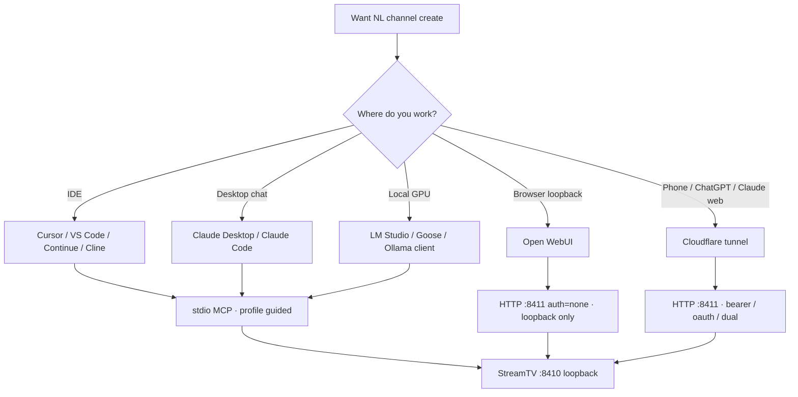

**GitHub one-liner** (clone public repo + interactive wire):

```bash
curl -fsSL https://raw.githubusercontent.com/roto31/StreamTV/main/scripts/install_channel_creator_mcp.sh | bash
```

**Interactive (existing checkout):**

```bash
bash scripts/setup_channel_creator_mcp.sh
```

**Generator:**

```bash
zsh scripts/channel_creator_mcp_hosts.zsh --host all --mode emit --profile guided
# Apply Cursor project config (backs up first):
zsh scripts/channel_creator_mcp_hosts.zsh --host cursor --mode apply --profile guided
```

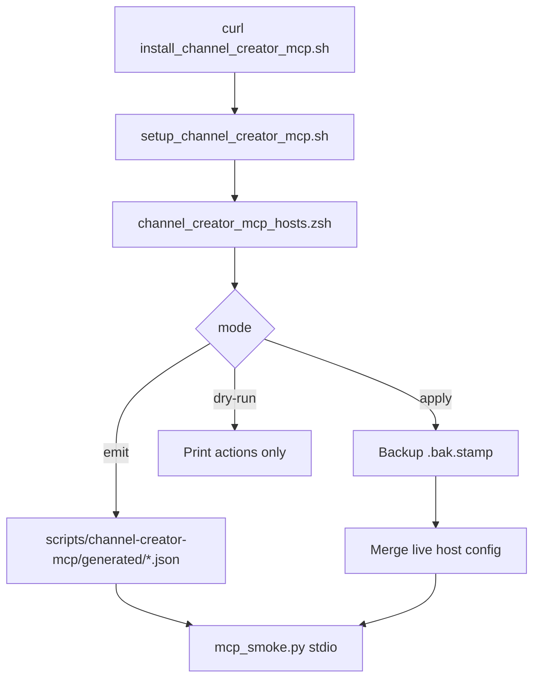

---

## 1. Shared prerequisites

| Requirement | Detail |
|-------------|--------|
| StreamTV API | `http://127.0.0.1:8410` — production LaunchAgent (repo cwd) |
| MCP package | `pip install -r requirements-mcp-streamtv.txt` |
| Default profile | `guided` (11 tools) |
| Default transport | **stdio** (local hosts) |
| Remote transport | Streamable HTTP `:8411` + `bearer` / `oauth` / `dual` |

```bash
export STREAMTV_BASE_URL=http://127.0.0.1:8410
export STREAMTV_MCP_PROFILE=guided
./venv/bin/python -m mcp_streamtv.main --profile guided --transport stdio
```

Smoke:

```bash
./venv/bin/python scripts/mcp_smoke.py --transport stdio --profile guided
```

Verify: tool count = 11 for `guided`; `channel_guide` returns intake text.

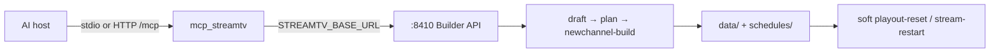

---

## 2. Cursor

```bash
zsh scripts/channel_creator_mcp_hosts.zsh --host cursor --mode apply --profile guided
```

Writes `.cursor/mcp.json` (backup `.bak.<stamp>`). Enable the
`streamtv-channel-creator` skill. First message: ask for a Christmas / holiday
channel in plain language.

**Verify:** guided tools visible; `channel_guide` works.

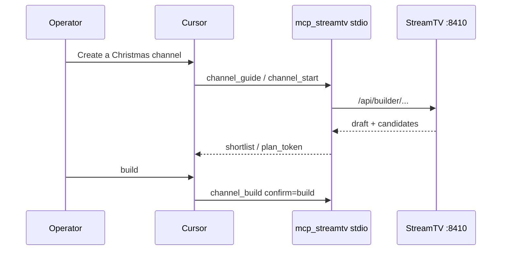

---

## 3. VS Code (Copilot agent / Continue / Cline)

```bash
zsh scripts/channel_creator_mcp_hosts.zsh --host vscode --mode emit --profile guided
zsh scripts/channel_creator_mcp_hosts.zsh --host continue --mode emit --profile guided
zsh scripts/channel_creator_mcp_hosts.zsh --host cline --mode emit --profile guided
```

VS Code uses `"servers"` + `"type": "stdio"`. Paste generated JSON into the host’s
MCP settings. Add intake as a system rule: resource `streamtv://prompts/channel-intake`.

**Verify:** `/streamtv.channel_intake` (or pasted intake) + tools work.

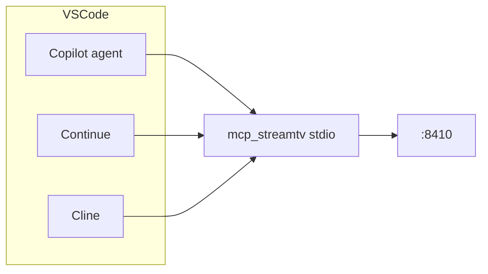

---

## 4. Claude Desktop

```bash
zsh scripts/channel_creator_mcp_hosts.zsh --host claude-desktop --mode emit --profile guided
```

Merge into `claude_desktop_config.json` `mcpServers`. Use prompt `channel_intake`.

**Verify:** prompt + tools work.

---

## 5. Claude Code

```bash
zsh scripts/channel_creator_mcp_hosts.zsh --host claude-code --mode emit --profile guided
```

Or: `claude mcp add streamtv-channel-creator -- ./venv/bin/python -m mcp_streamtv.main --profile guided`

**Verify:** `claude mcp list` shows the server; `channel_guide` runs.

---

## 6. LM Studio / Goose / local models

```bash
zsh scripts/channel_creator_mcp_hosts.zsh --host lmstudio --mode emit --profile guided
zsh scripts/channel_creator_mcp_hosts.zsh --host goose --mode emit --profile guided
```

Use **compact** intake (`channel_intake_compact` / resource) for small context.
Recommended local models: Qwen3 32B · Llama 3.3 70B · Qwen3 8B (tight RAM).

**Verify:** flow up to plan preview (`channel_plan`).

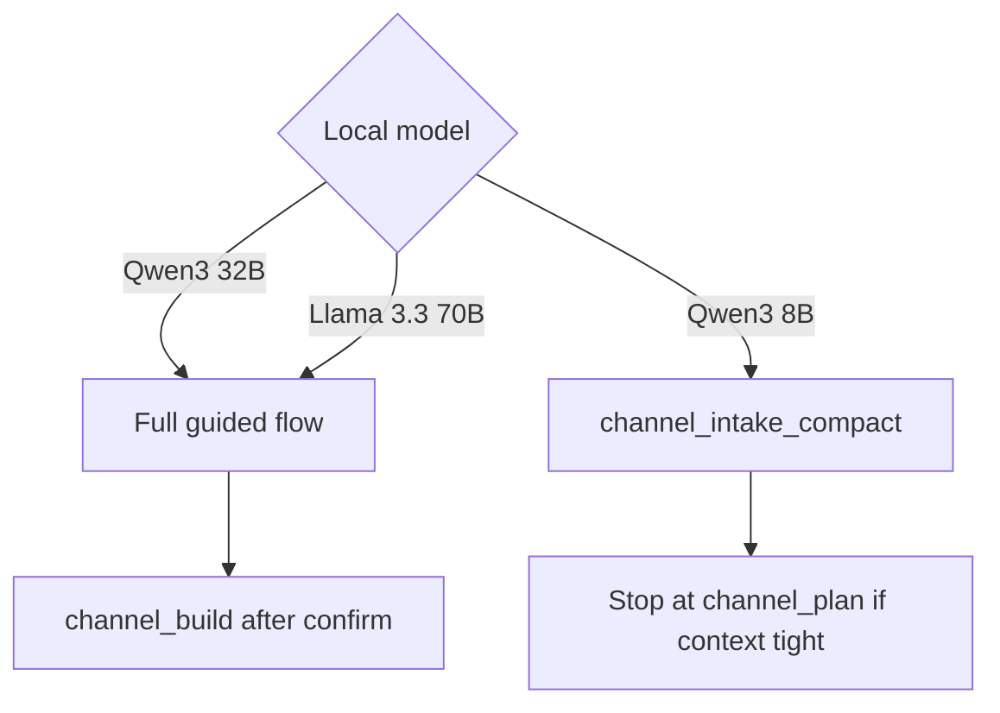

---

## 7. Open WebUI (loopback HTTP)

```bash
./venv/bin/python -m mcp_streamtv.main --transport http --host 127.0.0.1 --port 8411 \
  --auth none --profile guided
```

```bash
zsh scripts/channel_creator_mcp_hosts.zsh --host open-webui --mode emit --profile guided
```

**Verify:** `channel_guide` and `channel_list` over `http://127.0.0.1:8411/mcp`.

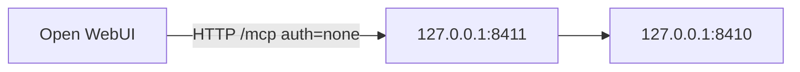

---

## 8. ChatGPT Developer mode + Claude web (remote)

Never expose `:8410`. Tunnel only MCP `:8411`.

```bash
export STREAMTV_MCP_AUTH=dual
export STREAMTV_MCP_TOKEN="$(openssl rand -hex 32)"
export STREAMTV_MCP_ACCESS_TEAM=myteam
export STREAMTV_MCP_ACCESS_AUDIENCE="<AUD>"

./venv/bin/python -m mcp_streamtv.main --transport http --host 127.0.0.1 --port 8411 \
  --auth dual --profile guided

zsh scripts/channel_creator_mcp_remote.zsh
# optional: --public-url https://YOUR_HOST/mcp
```

| App | Values |
|-----|--------|
| ChatGPT | MCP URL `https://YOUR_HOST/mcp`; Bearer token (dual Lock 2) or OAuth Sign-in |
| Claude web | Settings → Connectors → custom connector → same URL + auth |

**Verify:** `channel_guide`, `channel_list`, plan preview; build only if profile is `guided` and plan allows write.

Auth details: [HTTP auth](Channel-Creator-MCP-Auth).

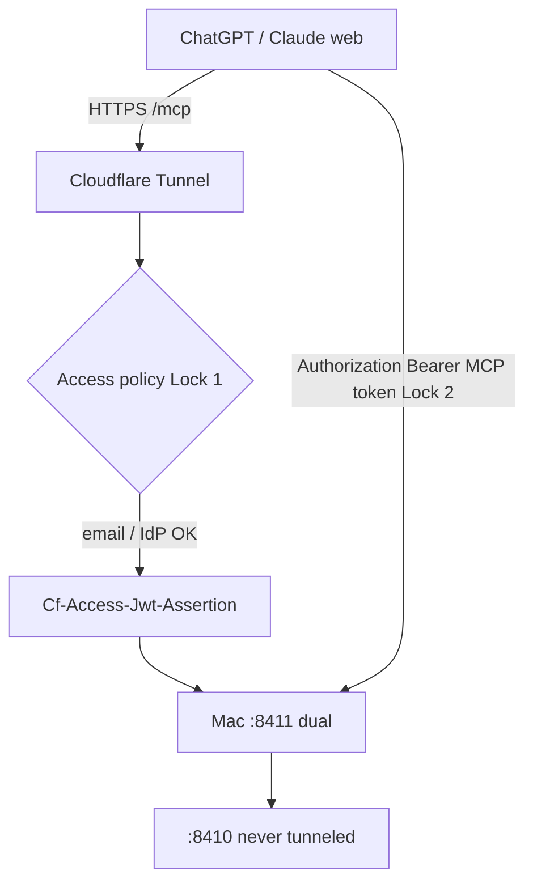

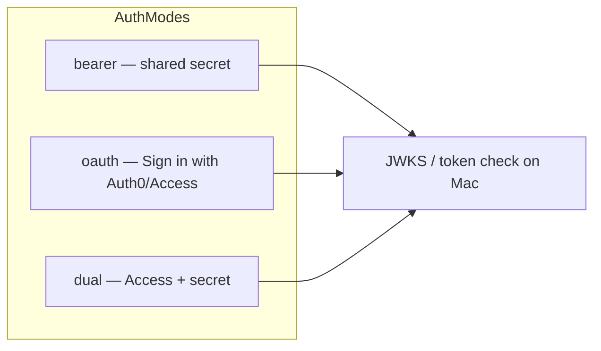

---

## 9. Profiles quick reference

| Profile | Tools | Notes |
|---------|-------|-------|
| `guided` | 11 `channel_*` | Default; includes `channel_build` |
| `planner` | guided minus build | Read / plan only |
| `builder` | guided + detail | Power users |
| `full` | + legacy names | May hit Cursor ~40 tool cap |

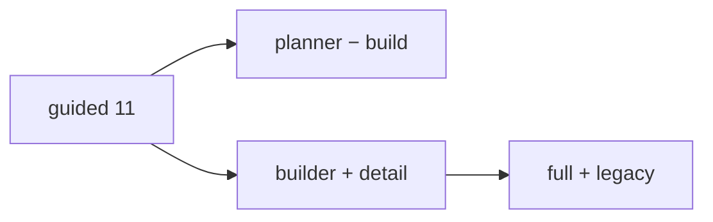

---

## 10. E2E rehearsal (throwaway)

```bash
zsh scripts/channel_creator_e2e_rehearsal.zsh
```

Uses isolated `STREAMTV_REPO_ROOT`; does not write production `data/`.

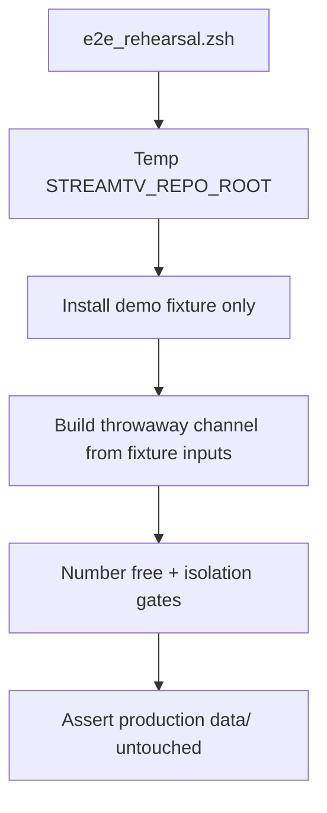
