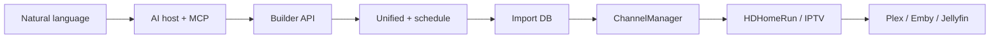
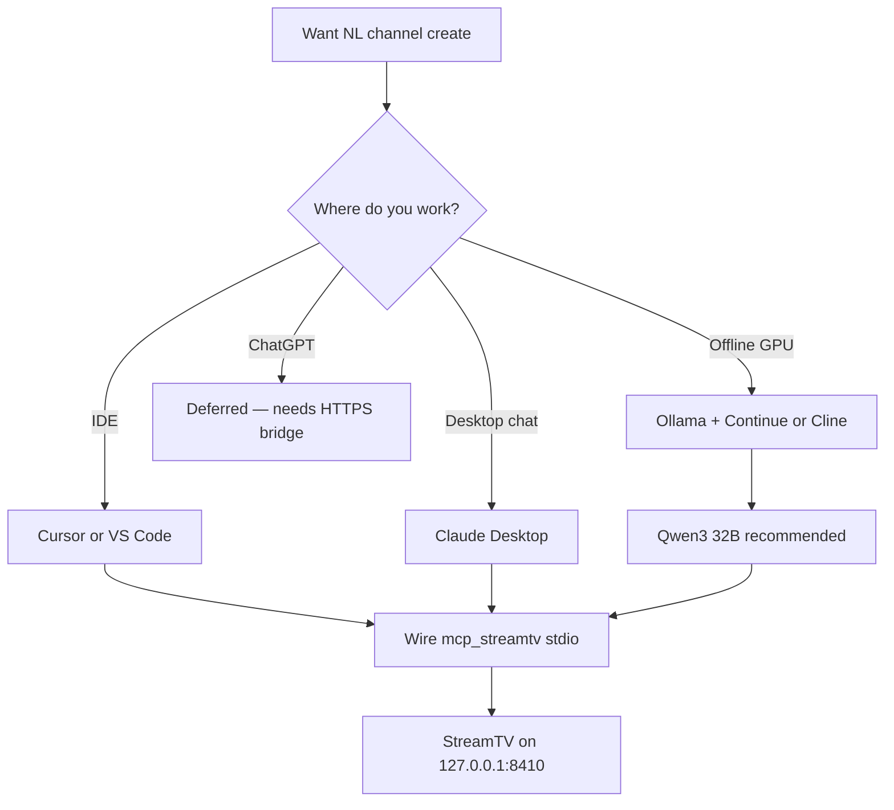
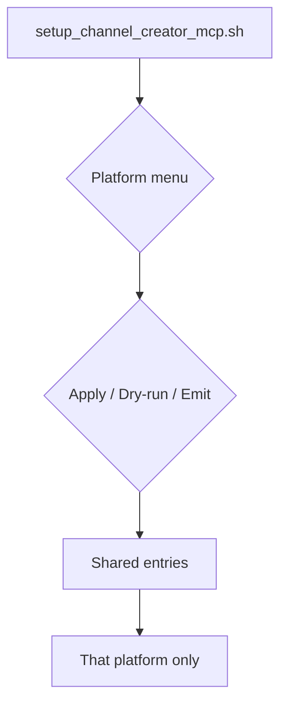

# Channel Creator MCP

Natural-language channel creation for StreamTV via a stdio **MCP** that drives the
Channel Builder HTTP API. The AI host never needs the streaming/FFmpeg source tree.

## Canonical docs

| Doc | Contents |
|-----|----------|
| [Channel Creator MCP](https://github.com/roto31/StreamTV/blob/main/docs/guides/CHANNEL_CREATOR_MCP.md) | Platform overview, create → tune signal paths, tools, Archive `.ia.mp4` ban |
| [Host wiring](https://github.com/roto31/StreamTV/blob/main/docs/guides/CHANNEL_CREATOR_MCP_HOST_WIRING.md) | **Cursor, VS Code, Claude Desktop, ChatGPT (deferred), local models** — configs + diagrams + all-in-one setup script |
| [Channel Builder](https://github.com/roto31/StreamTV/blob/main/docs/channel-builder.md) | Web/API Builder |
| [ARCHITECTURE.md](https://github.com/roto31/StreamTV/blob/main/ARCHITECTURE.md) | §8 Channel Creator MCP |
| [Soft deploy](https://github.com/roto31/StreamTV/blob/main/docs/guides/SOFT_DEPLOY.md) | Stream restart without uvicorn kickstart |

## Create → tune signal path



## Which host to use



| Host | Recommended | Config sketch |
|------|-------------|-----------------|
| **Cursor** | Best | MCP servers + skill `streamtv-channel-creator` |
| **VS Code** | Continue or Cline + same MCP | System rule = intake prompt |
| **Claude Desktop** | `claude_desktop_config.json` | Prompt `channel_intake` |
| **Local** | **Qwen3 32B**; Llama 3.3 70B if 40+ GB; Qwen3 8B if tight | Same MCP; stricter “say **build**” |
| **ChatGPT** | Not in this release | Future Actions / remote MCP only |

Full JSON examples and verify steps: [Host wiring guide](https://github.com/roto31/StreamTV/blob/main/docs/guides/CHANNEL_CREATOR_MCP_HOST_WIRING.md).

## Optional all-in-one setup script

```bash
bash scripts/setup_channel_creator_mcp.sh
```



Prompts for platform and mode (no flags required). See [Host wiring — Setup script](https://github.com/roto31/StreamTV/blob/main/docs/guides/CHANNEL_CREATOR_MCP_HOST_WIRING.md).

## Quick start (any host)

1. Run StreamTV on `http://127.0.0.1:8410`
2. Prefer: `bash scripts/setup_channel_creator_mcp.sh` — or manually `pip install -r requirements-mcp-streamtv.txt`
3. Register `python3 -m mcp_streamtv.main` (cwd = StreamTV checkout, env `STREAMTV_BASE_URL`)
4. Optional: `mcp_archive_org` for Archive discovery
5. Ask to create a channel → answer **Search vs Paste** → confirm shortlist → **build**

## Hard rules

- Prefer Builder over hand-written YAML for new URL-based channels
- **Never** use Archive.org `*.ia.mp4` derivative URLs — canonical
  `…/download/<id>/<file>.mp4` only
- Soft deploy / stream-restart after create — not a full process kickstart for data-only changes
