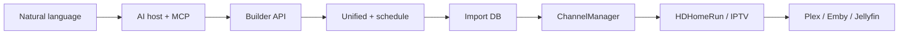
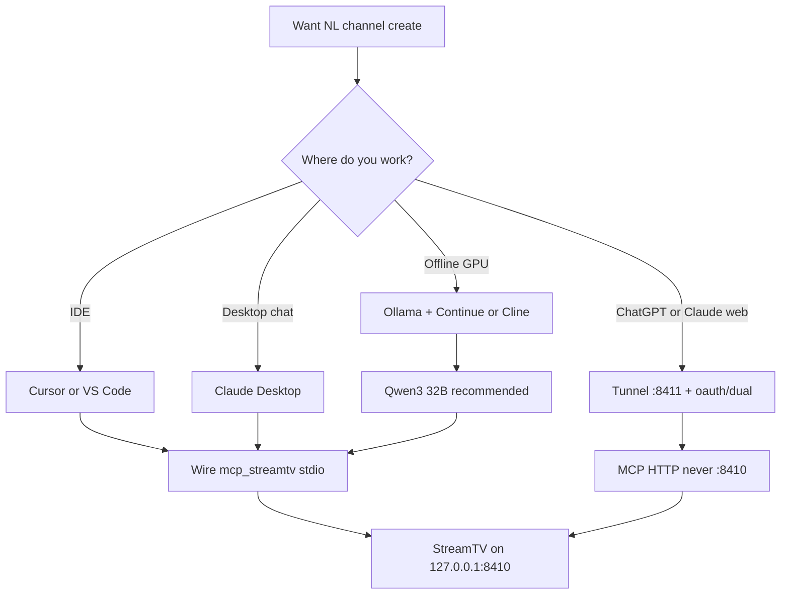
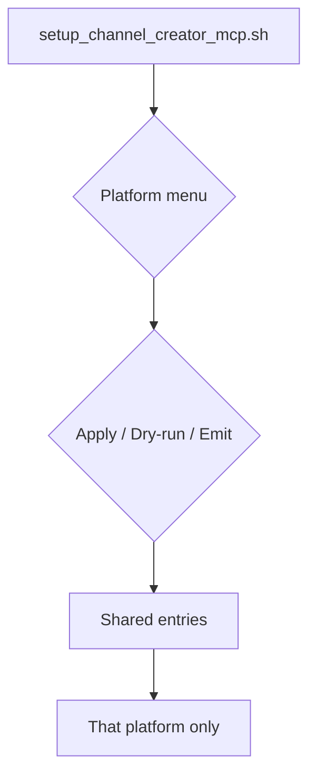

# Channel Creator MCP

Natural-language **new-channel** creation for StreamTV via MCP (`guided` profile)
that drives the Channel Builder HTTP API. Local hosts use **stdio**; remote
ChatGPT / Claude web use Streamable HTTP on **`:8411`** (`oauth` / `dual` — never
tunnel `:8410`). The AI host never needs the streaming/FFmpeg source tree.

## Canonical docs

| Doc | Contents |
|-----|----------|
| [Channel Creator MCP](https://github.com/roto31/StreamTV/blob/main/docs/guides/CHANNEL_CREATOR_MCP.md) | Platform overview, create → tune signal paths, tools, Archive `.ia.mp4` ban |
| [Host wiring](https://github.com/roto31/StreamTV/blob/main/docs/guides/CHANNEL_CREATOR_MCP_HOST_WIRING.md) | Cursor, VS Code, Claude Desktop/Code, local models, ChatGPT/Claude web via tunnel |
| [MCP auth](https://github.com/roto31/StreamTV/blob/main/docs/guides/CHANNEL_CREATOR_MCP_AUTH.md) | `bearer` / `oauth` / `dual` for Streamable HTTP `:8411` |
| [Channel Builder](https://github.com/roto31/StreamTV/blob/main/docs/channel-builder.md) | Web/API Builder |
| [ARCHITECTURE.md](https://github.com/roto31/StreamTV/blob/main/ARCHITECTURE.md) | §8 Channel Creator MCP |
| [Soft deploy](https://github.com/roto31/StreamTV/blob/main/docs/guides/SOFT_DEPLOY.md) | Stream restart without uvicorn kickstart |

## Create → tune signal path



## Which host to use



| Host | Recommended | Config sketch |
|------|-------------|-----------------|
| **Cursor** | Best | `channel_creator_mcp_hosts.zsh` + skill `streamtv-channel-creator` |
| **VS Code** | Continue or Cline + same MCP | System rule = intake prompt |
| **Claude Desktop** | `claude_desktop_config.json` | Prompt `channel_intake` |
| **Local** | **Qwen3 32B**; Llama 3.3 70B if 40+ GB; Qwen3 8B if tight | Compact intake |
| **ChatGPT / Claude web** | Tunnel `:8411` | Auth guide — `oauth` or `dual` |

Full JSON examples and verify steps: [Host wiring guide](https://github.com/roto31/StreamTV/blob/main/docs/guides/CHANNEL_CREATOR_MCP_HOST_WIRING.md).

## Host config generator

```bash
zsh scripts/channel_creator_mcp_hosts.zsh --host all --mode emit --profile guided
bash scripts/setup_channel_creator_mcp.sh   # legacy interactive installer
```



Prompts for platform and mode (no flags required). See [Host wiring — Setup script](https://github.com/roto31/StreamTV/blob/main/docs/guides/CHANNEL_CREATOR_MCP_HOST_WIRING.md).

## Quick start (any host)

1. Run StreamTV on `http://127.0.0.1:8410`
2. `pip install -r requirements-mcp-streamtv.txt`
3. Prefer: `zsh scripts/channel_creator_mcp_hosts.zsh --host cursor --mode apply --profile guided`
4. Register `./venv/bin/python -m mcp_streamtv.main --profile guided` (cwd = checkout, `STREAMTV_BASE_URL`)
5. Ask to create a channel → **audience** → Search vs Paste → shortlist → plan → say **build**

## Hard rules

- Prefer Builder over hand-written YAML for new URL-based channels
- **Never** use Archive.org `*.ia.mp4` derivative URLs — canonical
  `…/download/<id>/<file>.mp4` only
- Soft deploy / stream-restart after create — not a full process kickstart for data-only changes
