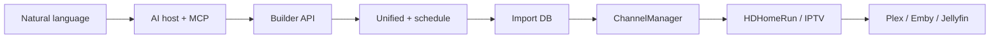

# Channel Creator MCP

Natural-language channel creation for StreamTV via a stdio **MCP** that drives the
Channel Builder HTTP API. The AI host never needs the streaming/FFmpeg source tree.

**Canonical guide (diagrams + tool catalog):**  
[Channel Creator MCP](https://github.com/roto31/StreamTV/blob/main/docs/guides/CHANNEL_CREATOR_MCP.md)

**Also:** [Channel Builder](https://github.com/roto31/StreamTV/blob/main/docs/channel-builder.md) ·
[ARCHITECTURE.md](https://github.com/roto31/StreamTV/blob/main/ARCHITECTURE.md) ·
[Soft deploy](https://github.com/roto31/StreamTV/blob/main/docs/guides/SOFT_DEPLOY.md)

## Signal path (summary)

Full create sequence, intake fork, Archive `.ia.mp4` ban, and post-create tune path are
Mermaid diagrams in the canonical guide above.

## Quick start

1. Run StreamTV on `http://127.0.0.1:8410`
2. `pip install -r requirements-mcp-streamtv.txt`
3. Wire `python3 -m mcp_streamtv.main` in Cursor / Claude Desktop / Continue
4. Optional: `mcp_archive_org` for Archive discovery
5. Ask the agent to create a channel; confirm Search vs Paste, then **build**

## Hard rules

- Prefer Builder over hand-written YAML for new URL-based channels
- **Never** use Archive.org `*.ia.mp4` derivative URLs — canonical
  `…/download/<id>/<file>.mp4` only
- Soft deploy / stream-restart after create — not a full process kickstart for data-only changes
