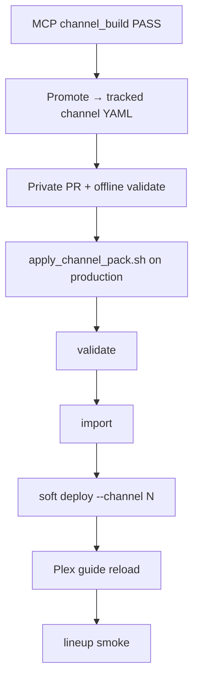

# Channel pack GitOps

Hybrid GitOps for **compiled** StreamTV channels: YAML in private git is desired state; apply on the production Mac reconciles DB + soft-deploy + Plex guide. Channel Creator MCP remains the **authoring** UX.

**Scope:** private source repo only. Channel inventory packs must **not** ship to the public StreamTV tree.



## Validate / apply

```bash
./venv/bin/python scripts/validate_channel_pack.py \
  --channel-yaml data/channels_${N}_${SLUG}.yaml \
  --schedule schedules/${N}.yml

bash scripts/apply_channel_pack.sh \
  --channel-yaml data/channels_${N}_${SLUG}.yaml \
  --schedule schedules/${N}.yml \
  --number "${N}"
```

Use **full kickstart** only for `streamtv/` module or LaunchAgent env changes — not for YAML pack apply ([Soft deploy](https://github.com/roto31/StreamTV/blob/main/docs/guides/SOFT_DEPLOY.md)).

Canonical: [CHANNEL_PACK_GITOPS.md](https://github.com/roto31/StreamTV/blob/main/docs/guides/CHANNEL_PACK_GITOPS.md) · [Channel-Creator-MCP](Channel-Creator-MCP) · [Import vs Builder](https://github.com/roto31/StreamTV/blob/main/docs/guides/IMPORT_VS_BUILDER.md).
