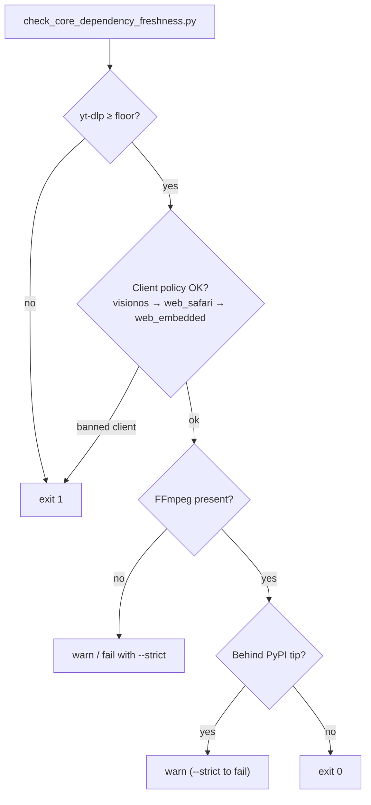

# Core dependency freshness

StreamTV’s YouTube path tracks **yt-dlp** and `player_client` policy. Stale extractors cause googlevideo **403** failures with no app code change.



## Commands

```bash
./venv/bin/python scripts/check_core_dependency_freshness.py
./venv/bin/python scripts/check_core_dependency_freshness.py --json
./venv/bin/python scripts/check_core_dependency_freshness.py --strict
```

First-run jobs call `ensure_yt_dlp_current()`. Keep the weekly `com.streamtv.ytdlp-upgrade` LaunchAgent bootstrapped.

## Preferred YouTube clients

1. `visionos`
2. `web_safari`
3. `web_embedded`

Do not prefer `android_vr` / `web` / `android` / `ios` / `mweb` without a PO Token provider.

Canonical: [CORE_DEPENDENCY_FRESHNESS.md](https://github.com/roto31/StreamTV/blob/main/docs/guides/CORE_DEPENDENCY_FRESHNESS.md) · [First-Run-Setup](First-Run-Setup).
