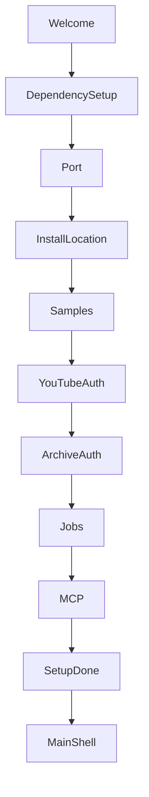
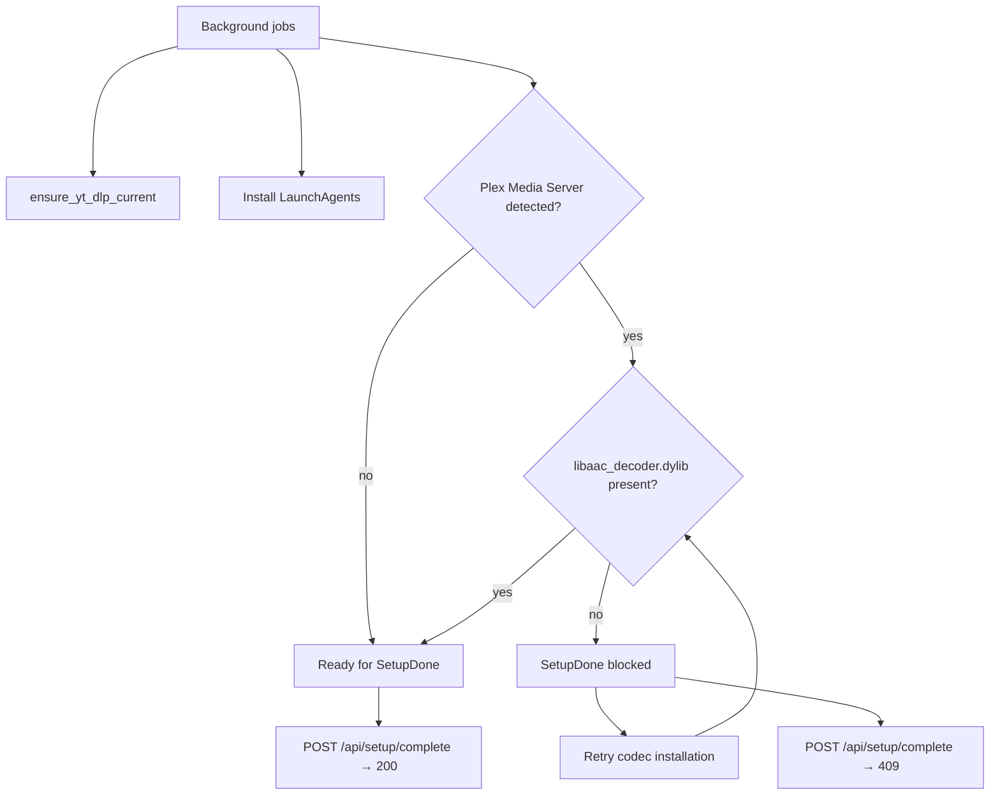

# First-run setup

StreamTV first-run runs through **StreamTV.app** onboarding (Welcome → DependencySetup → Port → Install location → Sample channels → YouTube/Archive sign-in → MCP offer → SetupDone). LaunchAgent-only installs use WebUI `/setup`.



## Prompts vs background

- **Prompted:** install location (Standard App Support vs Advanced repo), optional sample channels, port, YouTube/Archive sign-in, MCP Yes/hosts, **Retry codec installation** when Plex is present but AAC packs are missing
- **Background:** config seed, FFmpeg/ffprobe, **yt-dlp floor/upgrade**, **Plex AAC codecs** verify/install, LaunchAgents (`com.streamtv`, yt-dlp upgrade, TunarrRAM heal if mounted), DB ready, auth status lines

Universal production bootstrap (no lab-specific settings): [Production-Bootstrap](Production-Bootstrap).

## Background jobs + SetupDone gate



## yt-dlp (not DMG-bundled)

yt-dlp installs into the active venv via `requirements.txt`. First-run jobs call `ensure_yt_dlp_current()`. Operator check:

```bash
./venv/bin/python scripts/check_core_dependency_freshness.py
```

See [Core-Dependency-Freshness](Core-Dependency-Freshness).

## Plex AAC codecs

When Plex Media Server is detected, **SetupDone is blocked** until `libaac_decoder.dylib` exists under Plex’s Application Support `Codecs/` folder. See [Plex-Playback-Error-Host](Plex-Playback-Error-Host).

Canonical guide: [FIRST_RUN_SETUP.md](https://github.com/roto31/StreamTV/blob/main/docs/guides/FIRST_RUN_SETUP.md) · Wiki: [SetupDone-and-Factory-Reset](SetupDone-and-Factory-Reset) · [Source-Auth-YouTube-Archive](Source-Auth-YouTube-Archive).
