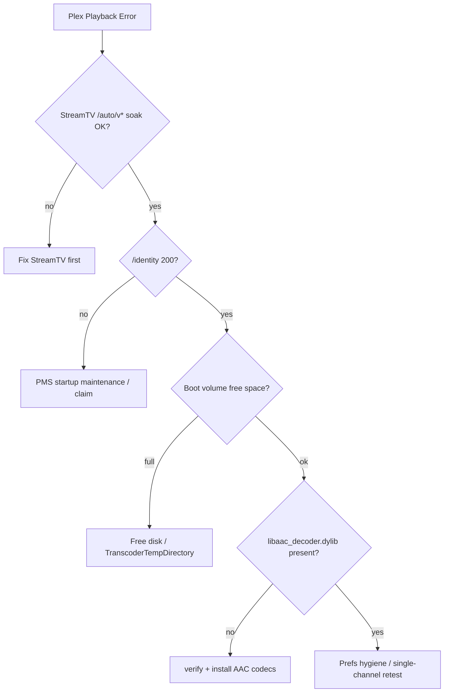

# Plex Playback Error (host triage)

When StreamTV preview/cache is healthy but Plex Live TV shows **Playback Error**, treat it as a **host / PMS** problem first — not streaming bedrock.



## Always (order)

1. Confirm production StreamTV on `:8410` (repo LaunchAgent vs Application Support test app).
2. Soak `http://127.0.0.1:8410/auto/v{N}` (≥50s for YouTube) — codecs + late-null %, not HTTP 200 alone.
3. Check boot Data volume free space (Plex Transcoder `ssegment` needs writable temp).
4. Treat `/identity` **200** as “Plex is up”. PID + 503 maintenance is not ready for Live TV.
5. Confirm Plex **AAC** pack: `libaac_decoder.dylib` under `~/Library/Application Support/Plex Media Server/Codecs/`.

## AAC codec scripts

```bash
bash scripts/verify_plex_aac_codecs.sh
bash scripts/install_plex_aac_codecs.sh
# optional donor from a healthy same-build host:
bash scripts/install_plex_aac_codecs.sh --from-dir "/path/to/healthy/Plex Media Server/Codecs"
```

First-run SetupDone **blocks** when Plex is detected and AAC codecs are missing ([First-Run-Setup](First-Run-Setup)).

Canonical: [PLEX_PLAYBACK_ERROR_HOST.md](https://github.com/roto31/StreamTV/blob/main/docs/guides/PLEX_PLAYBACK_ERROR_HOST.md) · [Plex-Integration](Plex-Integration).
