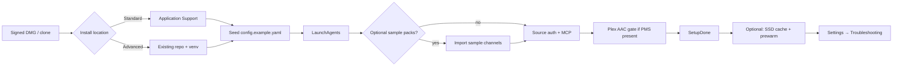

# Production bootstrap (universal)

Goal: a brand-new Mac gets a Studio-class StreamTV server **without** copying lab-specific settings (LAN IPs, TunarrRAM paths, Plex `dvr_id`, private fleet YAML).

After SetupDone, see [Streaming-Resilience-Ops](Streaming-Resilience-Ops) for SSD keep-warm / pre-warm LaunchAgent.

## What first-run installs

| Piece | Behavior |
|-------|----------|
| Config | Seeded from `config.example.yaml` (`base_url` localhost) |
| venv + deps | Application Support (app) or existing repo venv (advanced) |
| yt-dlp | Floor / tip ensure |
| `com.streamtv` | LaunchAgent — WorkingDirectory = chosen workdir |
| `com.streamtv.ytdlp-upgrade` | Weekly upgrade agent |
| TunarrRAM heal | Only if `/Volumes/TunarrRAM` already exists |
| Plex AAC | Hard gate when PMS is detected |
| Sample channels | Optional curated packs in product builds (not published as public channel inventory) |

## Install location

- **Standard:** `~/Library/Application Support/StreamTV`
- **Advanced:** user-selected repo path — must already contain `venv/` and importable `streamtv`

## Never auto-copied

- Lab workdirs, LAN base URLs, cookies, private fleet YAML
- Studio LaunchAgent environment overrides (`STREAMTV_CACHE_YOUTUBE_FULL_CACHE`, etc.)

## Optional after first-run

1. Mount TunarrRAM → install heal agent → enable `youtube_full_cache` if desired.
2. Set Plex hosts for your LAN.
3. Add StreamTV as HDHomeRun in Plex; reload guide after lineup exists.
4. Import your own channel packs ([Channel-Pack-GitOps](Channel-Pack-GitOps)).

Canonical: [PRODUCTION_BOOTSTRAP_UNIVERSAL.md](https://github.com/roto31/StreamTV/blob/main/docs/guides/PRODUCTION_BOOTSTRAP_UNIVERSAL.md) · [First-Run-Setup](First-Run-Setup).
