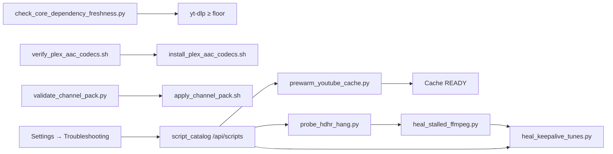

# Scripts and Tools

Complete documentation for all StreamTV utility scripts and tools.

> **Heal / soft-deploy scripts (tip):** `scripts/heal_stalled_ffmpeg.py`, `scripts/heal_playout_lag.py`, `scripts/heal_tunarr_ram.sh`, `scripts/deploy_soft.sh` — see [SOFT_DEPLOY](https://github.com/roto31/StreamTV/blob/main/docs/guides/SOFT_DEPLOY.md), [FFMPEG_STALL_KEEPALIVE](https://github.com/roto31/StreamTV/blob/main/docs/guides/FFMPEG_STALL_KEEPALIVE.md), [TUNARRRAM](https://github.com/roto31/StreamTV/blob/main/docs/guides/TUNARRRAM_PLAYOUT_RECOVERY.md). macOS install: prefer [Releases DMG](https://github.com/roto31/StreamTV/releases) or `packaging/macos/install_macos.sh` (not `./install_macos.sh` at repo root).

## First-run / freshness / Plex AAC (v1.4.7+)

| Script | Purpose |
|--------|---------|
| `scripts/check_core_dependency_freshness.py` | yt-dlp floor + player-client policy + FFmpeg ([Core-Dependency-Freshness](Core-Dependency-Freshness)) |
| `scripts/verify_plex_aac_codecs.sh` | Confirm `libaac_decoder.dylib` under Plex Codecs |
| `scripts/install_plex_aac_codecs.sh` | Trigger PMS download / optional `--from-dir` donor |
| `scripts/install-com-streamtv-launchagent.sh` | Production `com.streamtv` LaunchAgent |
| `scripts/validate_starter_pack.py` | Validate optional sample packs (product builds) |
| `scripts/validate_channel_pack.py` | Offline channel+schedule GitOps gate |
| `scripts/apply_channel_pack.sh` | Import → soft deploy → Plex guide reload ([Channel-Pack-GitOps](Channel-Pack-GitOps)) |
| `scripts/apply_public_update.sh` | In-app / Settings → Updates apply path |

## Keep-warm / playback (Phase 3 parked)

| Script | Purpose |
|--------|---------|
| `scripts/prewarm_youtube_cache.py` | Sequential HDHR cold-tune pre-warm (YouTube + Archive); `--from-lineup` for full lineup |
| `scripts/kickstart_streamtv_with_prewarm.sh` | Kickstart `com.streamtv` then pre-warm |
| `scripts/install-prewarm-youtube-launchagent.sh` | Optional daily 17:00 pre-warm LA (`--from-lineup`) |
| `scripts/heal_streamtv_ssd_cache.py` | Enforce media-cache ceiling (default 30 GiB) / free-floor (15 GiB) |
| `scripts/install-streamtv-ssd-cache-heal-launchagent.sh` | Install `com.streamtv.ssd-cache-heal` (~120s) |
| `scripts/heal_stalled_ffmpeg.py` | Lesson 41 Archive FFmpeg keepalive wedge (etime≥90s) |
| `scripts/heal_keepalive_tunes.py` | Lesson 41b: keepalive-only `/hdhomerun/auto/v*` → kill + soft-restart |
| `scripts/warm_archive_probe_cache.py` | Lesson 41c/75: seed Archive probe sidecars (`--channel N --apply`); uses Archive cookies |
| `scripts/report_archive_hold_geometry.py` | Lesson 41c: which hold TS (480/720/skip) each Archive item would use |
| `scripts/report_archive_hevc_twins.py` | Report-only HEVC vs h264 twin inventory (no auto remap) |
| `scripts/prune_dead_archive_urls.py` | Lesson 75: metadata-safe prune only (`UNCERTAIN`/401 keep) |
| `scripts/check_yaml_url_dedupe.py` | Within-channel URL uniqueness audit |
| `scripts/dedupe_yaml_stream_urls.py` | Schedule-aware URL twin repair |
| `scripts/install-stalled-ffmpeg-heal-launchagent.sh` | Install stall + keepalive heal LA (~120s) |
| `scripts/probe_hdhr_hang.py` | Detect keepalive-only / stalled FFmpeg |
| `scripts/deploy_soft.sh` | Soft-restart channel streams |

**UI:** Settings → Troubleshooting / nav **Troubleshooting → Scripts** (`streamtv/troubleshooting/script_catalog.py`). See [Streaming-Resilience-Ops](Streaming-Resilience-Ops).



Archive probe miss class: [ARCHIVE_PROBE_RETRY_KEEPALIVE](https://github.com/roto31/StreamTV/blob/main/docs/guides/ARCHIVE_PROBE_RETRY_KEEPALIVE.md).

# Scripts

Utility scripts for managing StreamTV.

## create_channel.sh (Zsh Script)

A zsh shell script that creates channels via the StreamTV API. This is the recommended method if the API server is running.

### Prerequisites

- StreamTV API server must be running (start with `python3 -m streamtv.main`)
- `curl` command available
- zsh shell

### Usage

#### Create all default channels (1980, 1984, 1988)

```bash
./scripts/create_channel.sh
```

#### Create a channel for a specific year

```bash
./scripts/create_channel.sh --year 1980
./scripts/create_channel.sh --year 1984
./scripts/create_channel.sh --year 1988
```

#### Create a custom channel

```bash
./scripts/create_channel.sh --number "1" --name "My Channel" --group "Entertainment"
```

#### Interactive mode

```bash
./scripts/create_channel.sh --interactive
```

#### Options

- `--year YEAR`: Create channel for specific Olympic year (1980, 1984, or 1988)
- `--number NUMBER`: Channel number (e.g., '1', '1980')
- `--name NAME`: Channel name
- `--group GROUP`: Channel group (default: 'StreamTV')
- `--logo PATH`: Path to channel logo image
- `--disabled`: Create channel as disabled (not enabled)
- `--interactive, -i`: Interactive mode for guided channel creation
- `--api-url URL`: API base URL (default: http://localhost:8410)
- `--token TOKEN`: Access token for authenticated API
- `--help, -h`: Show help message

#### Environment Variables

- `STREAMTV_API_URL`: API base URL (overrides --api-url)
- `STREAMTV_ACCESS_TOKEN`: Access token (overrides --token)

#### Examples

```bash
# Create all default channels
./scripts/create_channel.sh

# Create just the 1980 channel
./scripts/create_channel.sh --year 1980

# Create a custom channel
./scripts/create_channel.sh --number "10" --name "Classic Sports" --group "Sports"

# Use custom API URL
./scripts/create_channel.sh --api-url http://127.0.0.1:8410

# Interactive mode
./scripts/create_channel.sh -i
```

#### Notes

- The script checks if the API server is running before attempting to create channels
- If the API server is not available, the script will fall back to the Python script method
- Channels are created via the REST API (requires running server)
- The script provides colored output for better readability

---

## create_channel.py (Python Script)

Creates channels for StreamTV. This script can create custom channels or channels for specific content.

### Prerequisites

Make sure you have installed the project dependencies:

```bash
pip install -r requirements.txt
```

### Usage

#### Create all default channels (1980, 1984, 1988)

```bash
python3 scripts/create_channel.py
```

This will create channels based on the configuration. Channels can be customized with names and groups.

#### Create a channel for a specific year

```bash
python3 scripts/create_channel.py --year 1980
python3 scripts/create_channel.py --year 1984
python3 scripts/create_channel.py --year 1988
```

#### Create a custom channel

```bash
python3 scripts/create_channel.py --number "1" --name "My Channel" --group "Entertainment"
```

#### Options

- `--year YEAR`: Create channel for specific Olympic year (1980, 1984, or 1988)
- `--number NUMBER`: Channel number (e.g., '1', '1980')
- `--name NAME`: Channel name
- `--group GROUP`: Channel group (default: 'StreamTV')
- `--logo PATH`: Path to channel logo image
- `--disabled`: Create channel as disabled (not enabled)

### Examples

```bash
# Create all default channels
python3 scripts/create_channel.py

# Create just the 1980 channel
python3 scripts/create_channel.py --year 1980

# Create a custom channel
python3 scripts/create_channel.py --number "10" --name "Classic Sports" --group "Sports"

# Create a disabled channel
python3 scripts/create_channel.py --number "99" --name "Test Channel" --disabled
```

### Notes

- The script will check if a channel with the same number already exists and skip creation if found
- Channels are created directly in the database (no API server required)
- The database will be initialized automatically if it doesn't exist

## Available Scripts

### Shell Scripts

#### Installation & Setup
- `install_macos.sh` - macOS installation
- `start_server.sh` - Start StreamTV server
- `verify-installation.sh` - Verify installation
- `install_channel_creator_mcp.sh` — GitHub one-liner bootstrap (clone + venv + setup)
- `setup_channel_creator_mcp.sh` — Interactive MCP host wiring (wraps hosts.zsh)
- `channel_creator_mcp_hosts.zsh` — Host config emit/apply/smoke
- `channel_creator_mcp_remote.zsh` — Cloudflare tunnel checklist (`bearer` / `oauth` / `dual`)
- `channel_creator_e2e_rehearsal.zsh` — Phase 7 throwaway e2e

### Channel Creator MCP setup

**GitHub one-liner:**

```bash
curl -fsSL https://raw.githubusercontent.com/roto31/StreamTV/main/scripts/install_channel_creator_mcp.sh | bash
```

**Existing checkout:**

```bash
bash scripts/setup_channel_creator_mcp.sh
zsh scripts/channel_creator_mcp_hosts.zsh --host all --mode emit --profile guided
zsh scripts/channel_creator_mcp_remote.zsh   # remote ChatGPT / Claude web
```

Guides: wiki [Host wiring](Channel-Creator-MCP-Host-Wiring) ·
[AUTH](Channel-Creator-MCP-Auth)

#### Channel Management
- `create_channel.sh` - Create channels via API
- `create_schedule.sh` - Optional helper that writes `schedules/{n}.yml` on disk (not a web UI; `/api/schedules` create returns **410**)

#### Archive.org Parser
- `archive_collection_parser_dialog.sh` - Interactive GUI parser

#### Troubleshooting
- `view-logs.sh` - View application logs
- `troubleshoot_streamtv.sh` - StreamTV diagnostics
- `troubleshoot_plex.sh` - Plex integration diagnostics
- `stop_server.sh` - Stop running server

#### GitHub & Distribution
- `upload-to-github.sh` - Upload distributions to GitHub
- `create-wiki.sh` - Create GitHub wiki
- `fix-unrelated-histories.sh` - Fix git history issues
- `push-distributions.sh` - Push distributions to GitHub

### Python Scripts

#### Channel Management
- `create_channel.py` - Create channels programmatically
- `import_channels.py` - Import channels from YAML
- `import_collections.py` - Legacy/parked collections import (Collections UI/`/api/collections` retired)
- `rename_channels.py` - Rename existing channels
- `remove_tpt_channels.py` - Remove specific channels

#### Archive.org Integration
- `archive_collection_parser.py` - Parse Archive.org collections
- `create_sesame_street_channel.py` - Create Sesame Street channel
- `create_mister_rogers_channel.py` - Create Mister Rogers channel

#### Channel Rebuilding
- `rebuild_1980_channel.py` - Rebuild 1980 channel
- `recreate_1980_channel.py` - Recreate 1980 channel
- `recreate_1992_channel.py` - Recreate 1992 channel
- `full_rebuild_1980.py` - Full rebuild of 1980 channel
- `complete_rebuild_1980.py` - Complete rebuild of 1980 channel

#### Metadata & Data
- `enrich_metadata.py` - Enrich media metadata
- `update_metadata.py` - Update existing metadata
- `import_olympics_data.py` - Import Olympics data
- `cleanup_placeholders.py` - Clean up placeholder entries

#### Plex Integration
- `discover_plex.py` - Discover Plex servers
- `get_plex_token.py` - Get Plex authentication token
- `test_plex_connection.py` - Test Plex connectivity

#### Utilities
- `health_check.py` - System health check
- `hardware_detection.py` - Detect hardware capabilities
- `test_logging.py` - Test logging system
- `test_connectivity.py` - Test network connectivity
- `auto_heal.py` - Auto-healing system
- `add_playout_mode_migration.py` - Database migration

## Usage Examples

### Create a Channel
```bash
# Using shell script (requires API server)
./scripts/create_channel.sh --year 1980

# Using Python script (direct database)
python3 scripts/create_channel.py --year 1980
```

### Parse Archive.org Collection
```bash
# Interactive GUI (recommended)
./scripts/archive_collection_parser_dialog.sh

# Command-line
python3 scripts/archive_collection_parser.py "https://archive.org/details/..."
```

### View Logs
```bash
# Live view
./scripts/view-logs.sh

# Search for errors
./scripts/view-logs.sh search ERROR
```

### Import Channels
```bash
python3 scripts/import_channels.py data/channels.yaml
```

## Related Pages

- [Home](Home)
- [Archive Parser](Archive-Parser)
- [Logging](Logging)
- [Plex Integration](Plex-Integration)
