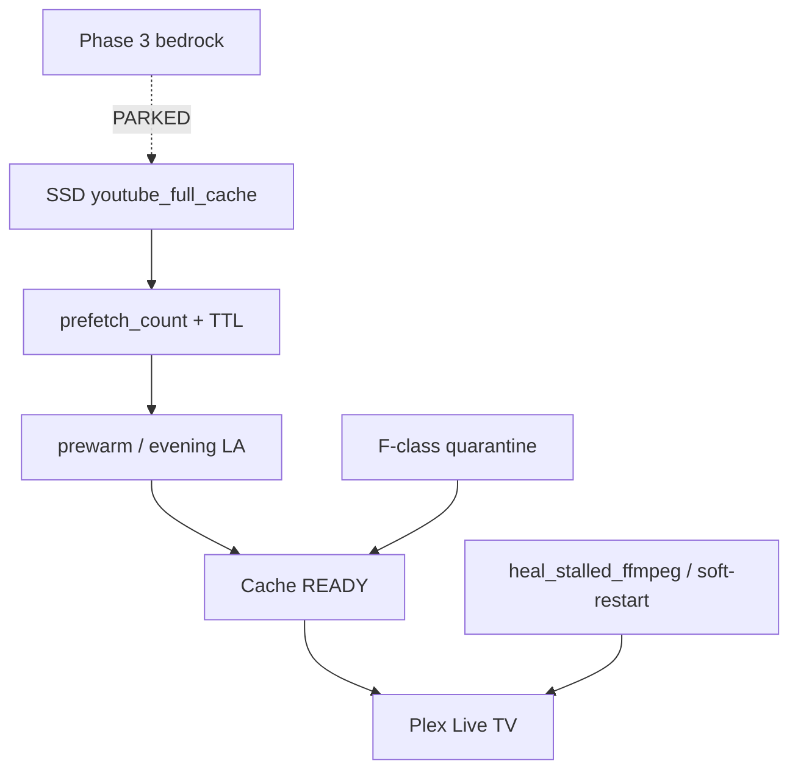

# Streaming resilience ops

Phase **3** (frozen-path packages **3a–3f**) is **PARKED** as of 2026-11-25. Reliability uses SSD cache, keep-warm config, F-class quarantine, and optional YouTube pre-warm.

Full operator guide: [STREAMING_RESILIENCE_OPS.md](https://github.com/roto31/StreamTV/blob/main/docs/guides/STREAMING_RESILIENCE_OPS.md) · Gate: [phase3-gate](https://github.com/roto31/StreamTV-source/blob/main/docs/plans/streaming-resilience-phase3-gate-20261125.md) (private plans may differ).

## Troubleshooting UI

Settings → **Troubleshooting** (Web UI + macOS app) lists public-safe scripts with hover help — see [Scripts-and-Tools](Scripts-and-Tools).
