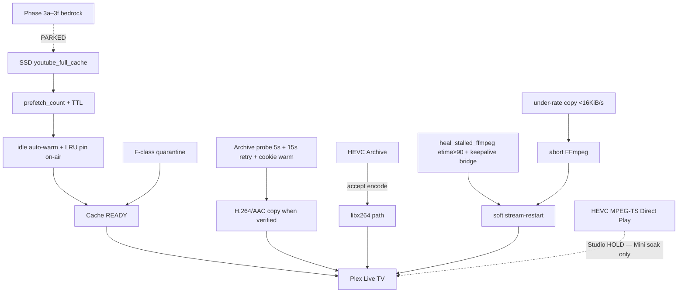
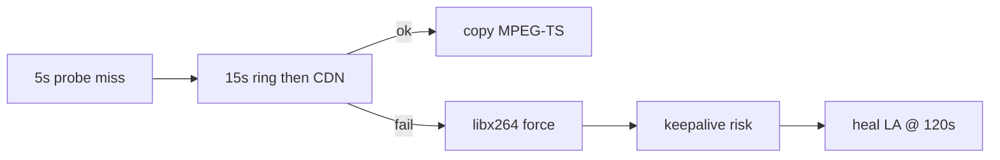
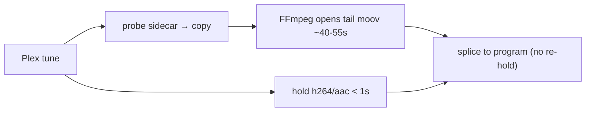

# Streaming resilience ops

Phase **3** (frozen-path packages **3a–3f**) is **PARKED** as of 2026-11-25 for most
CDN-first experiments. Tip reliability still ships **ops + approved bedrock** for
cold YouTube auto-warm and **Archive probe retry / keepalive heal** (Lesson **41b**).

Full operator guide: [STREAMING_RESILIENCE_OPS.md](https://github.com/roto31/StreamTV/blob/main/docs/guides/STREAMING_RESILIENCE_OPS.md) ·
Archive probe feature: [ARCHIVE_PROBE_RETRY_KEEPALIVE.md](https://github.com/roto31/StreamTV/blob/main/docs/guides/ARCHIVE_PROBE_RETRY_KEEPALIVE.md) ·
Gate notes: [phase3-gate](https://github.com/roto31/StreamTV-source/blob/main/docs/plans/streaming-resilience-phase3-gate-20261125.md) (private plans may differ).

## Archive probe miss → keepalive (Lesson 41b)

Multi-GB Archive CDN objects can miss the 5 s quick ffprobe → Issue 23 force-transcode
→ HDHomeRun **8192** keepalive until Plex drops. Tip retries probe once (ring `.part`
then CDN), and the stall LaunchAgent heals residual 0% CPU / keepalive-only tunes.

## Non-faststart Archive slow open (Lesson 41c)

Some multi-GB Archive MP4s keep the `moov` index at the file tail, so a cold open takes
~40–55 s. Allowlisted channels (`STREAMTV_PLEX_VIDEO_HOLD_ARCHIVE_CHANNELS`, e.g. `1984.2`)
show real hold video immediately and splice to the program once FFmpeg delivers. A probe
sidecar cache keeps copy mode consistent, and Archive inputs get a 60 s first-chunk budget.

Seed sidecars: `scripts/warm_archive_probe_cache.py --channel N --apply` (cookie-aware).
Details: [Layer C](https://github.com/roto31/StreamTV/blob/main/docs/guides/ARCHIVE_PROBE_RETRY_KEEPALIVE.md#layer-c--non-faststart-slow-open-lesson-41c) ·
[Layer B2 under-rate](https://github.com/roto31/StreamTV/blob/main/docs/guides/ARCHIVE_PROBE_RETRY_KEEPALIVE.md#layer-b2--under-rate-copy-trickle-plex-black) ·
[Layer D auth inventory](https://github.com/roto31/StreamTV/blob/main/docs/guides/ARCHIVE_PROBE_RETRY_KEEPALIVE.md#layer-d--inventory-vs-playback-auth-lesson-75).

## HEVC / Direct Play (decision)

Production **accepts encode** for HEVC Archive items. Do **not** enable HEVC
MPEG-TS copy / Live TV Direct Play on Studio until a Mini fork soak proves Plex
Apple TV Direct Play. Twin remaps are report-only / curated
(`scripts/report_archive_hevc_twins.py`).

## Troubleshooting UI

Settings → **Troubleshooting** (Web UI + macOS app) lists public-safe scripts with hover help — see [Scripts-and-Tools](Scripts-and-Tools).
