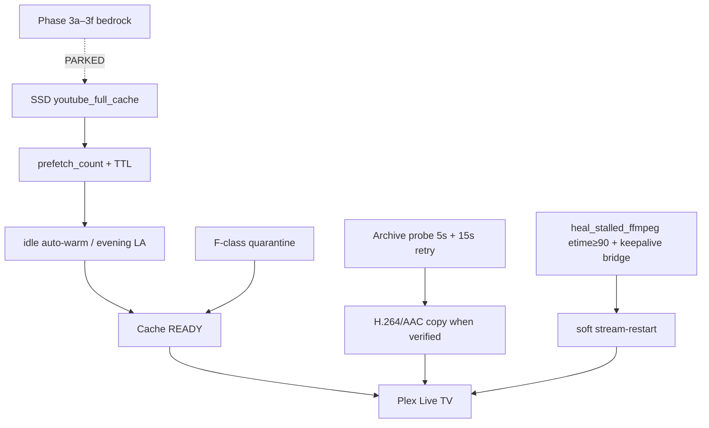
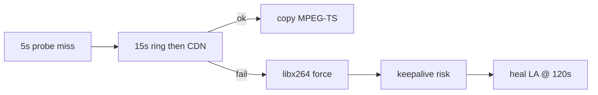

# Streaming resilience ops

Phase **3** (frozen-path packages **3a–3f**) is **PARKED** as of 2026-11-25 for most
CDN-first experiments. Tip reliability still ships **ops + approved bedrock** for
cold YouTube auto-warm and **Archive probe retry / keepalive heal** (Lesson **41b**).

Full operator guide: [STREAMING_RESILIENCE_OPS.md](https://github.com/roto31/StreamTV/blob/main/docs/guides/STREAMING_RESILIENCE_OPS.md) ·
Archive probe feature: [ARCHIVE_PROBE_RETRY_KEEPALIVE.md](https://github.com/roto31/StreamTV/blob/main/docs/guides/ARCHIVE_PROBE_RETRY_KEEPALIVE.md) ·
Gate notes: [phase3-gate](https://github.com/roto31/StreamTV-source/blob/main/docs/plans/streaming-resilience-phase3-gate-20261125.md) (private plans may differ).

## Archive probe miss → keepalive (Lesson 41b)

Multi-GB Archive CDN objects can miss the 5 s quick ffprobe → Issue 23 force-transcode
→ HDHomeRun **8192** keepalive until Plex drops. Tip retries probe once (ring `.part`
then CDN), and the stall LaunchAgent heals residual 0% CPU / keepalive-only tunes.

## Troubleshooting UI

Settings → **Troubleshooting** (Web UI + macOS app) lists public-safe scripts with hover help — see [Scripts-and-Tools](Scripts-and-Tools).
